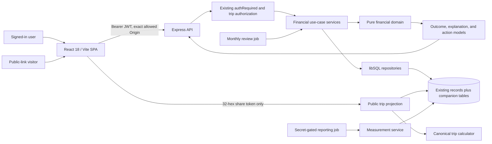
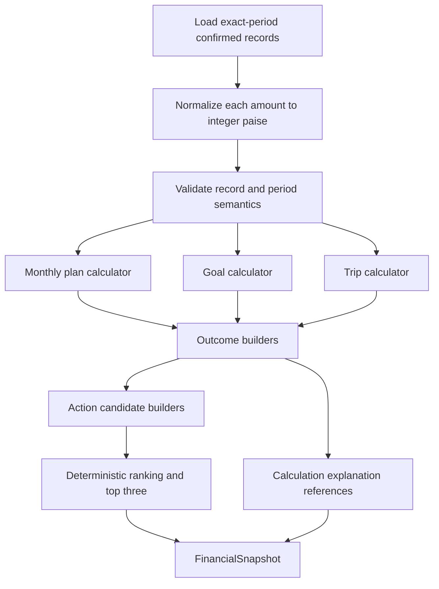
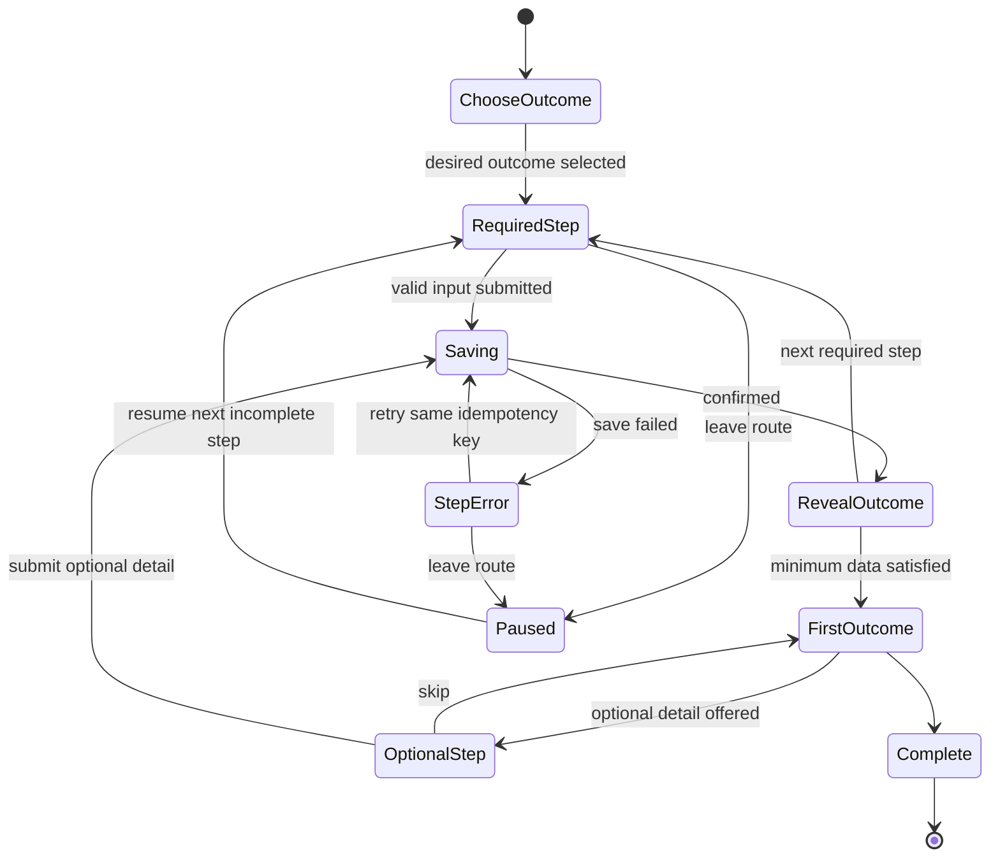

# Financial Clarity Experience Design

## Overview

The Financial Clarity Experience turns the existing Home, Plan, Spending, Goals, and Trips pages into one outcome-led system. It keeps the current React 18/Vite SPA, Express API, libSQL data, JWT sessions, visual language, and public trip links. It adds one server-owned financial domain layer, a resumable first-session journey, structured outcome and action contracts, and a client mutation model that updates only affected records and outcomes.

The design favors incremental replacement over a rewrite:

- Existing tables remain the source records. New columns and small companion tables add missing semantics without rewriting prior data.
- Existing authenticated finance and trip routes remain available. They delegate to the new domain layer and gain backward-compatible response fields.
- Existing pages remain route-level entry points. Shared outcome, explanation, purpose, and mutation-status components replace page-specific calculations and copy in stages.
- The existing unauthenticated `GET /api/public/trips/:token` contract and 32-character token behavior remain available. Its settlement math moves to the canonical trip calculator, while its sanitized projection remains unchanged.
- Derived outcomes are calculated on demand. They are not stored as competing financial records.

### Goals

1. Put the core promise and the current decision before forms or feature descriptions.
2. Let a new user reach a personalized answer in at most three required steps.
3. Make every page and the monthly review consume the same calculation results.
4. Make each result explainable from confirmed source values, operations, period, precision, and rounding.
5. Replace page reloads and page-wide busy states with immediate, per-record feedback and safe rollback.
6. Preserve authorization, exact-origin CORS, session revocation, public-share sanitization, export, deletion, and user control.
7. Measure understanding and action without collecting financial values, names, notes, trip identities, or member identities as product analytics.

### Non-goals

- Bank connections, transaction imports, investment advice, forecasting beyond the approved formulas, and a new authentication mechanism are out of scope.
- The design does not replace Express, React Router, libSQL, the existing JWT/session model, or Render deployment.
- The design does not merge the `emis` and `recurring_expenses` schemas. It only gives bill records the effective-period fields required by monthly calculations.
- The design does not make private financial outcomes available through public trip links.
- The design does not reinterpret old financial records silently. Legacy values remain intact and are normalized only at the calculation boundary.

### Research Findings From the Existing Repository

The design is based on the approved requirements and the following implementation findings:

| Existing behavior | Evidence | Design consequence |
|---|---|---|
| Monthly-plan math is in the finance route, while spending guidance is recalculated in the browser and savings math is repeated by the monthly email job. | `backend/src/routes/finance.js`, `frontend/src/insights.ts`, `backend/src/jobs/monthlyReview.js` | Move all authoritative calculations into pure backend domain modules. The browser renders returned outcomes; the monthly job calls the same service. |
| Authenticated and public trip routes contain separate settlement implementations. | `backend/src/routes/trips.js`, `backend/src/routes/public.js` | Use one trip allocation/settlement module and apply separate authenticated and public projections after calculation. |
| Plan currently reloads the whole document after a pay or bill change. Other components mix optimistic record updates with broad refetches and component-wide `busy` flags. | `frontend/src/pages/Plan.tsx`, `frontend/src/components/PlanInputs.tsx`, `frontend/src/components/SpendingTracker.tsx`, `frontend/src/components/SavingsGoals.tsx`, `frontend/src/pages/TripDetail.tsx` | Add a shared in-memory query cache, ordered optimistic patches, idempotent mutations, and a keyed mutation registry. Remove `window.location.reload()`. |
| The API client has no server-state cache and stores only auth plus a session-scoped plan cache. | `frontend/src/api.ts`, `frontend/src/hooks/useCachedPlan.ts` | Add TanStack Query for server state. Keep auth tokens in `sessionStorage`, keep financial snapshots in memory, and clear all financial queries on logout. |
| Salary is already month-keyed, but bills have no effective month or active state. Expense updates are absent. Goal validation permits states outside the approved requirements. | `backend/src/db/index.js`, `backend/src/routes/finance.js` | Add bill effective-period fields, an expense PATCH operation, strict goal use cases, and compatibility handling for legacy records. |
| Public trip links are disabled by default and expose sanitized trip/member/expense fields without member email addresses. | `frontend/src/components/TripShareLink.tsx`, `backend/src/routes/public.js` | Preserve the route and output. Add a separate field-disclosure confirmation before enabling or rotating a disabled link. |
| Exact-origin CORS, HS256 JWT verification, per-session revocation, token-version revocation, JSON size limits, rate limiting, and ownership checks already protect the API. | `backend/src/server.js`, `backend/src/middleware/auth.js`, `backend/src/routes/visits.js` | Mount new private endpoints behind `authRequired`, retain owner/member authorization, retain the existing CORS allowlist, and add no new public listener or auth scheme. |
| Export and deletion enumerate user-owned tables explicitly instead of relying only on foreign-key cascades. | `backend/src/routes/auth.js`, `frontend/src/components/DangerZone.tsx` | Add every new table to both code paths and make deletion transactional with explicit incomplete-deletion reporting. |
| The current CSS already provides mobile layouts, 44-pixel controls, focus outlines, and a reduced-motion rule. | `frontend/src/styles.css` | Extend these conventions, add region-level status styling and live announcements, and verify the full 320–3840 CSS-pixel range. |

These findings favor a server-owned calculation boundary, additive schema changes, and a staged migration that preserves the current security and public-sharing contracts.

### Key Design Decisions

1. **The backend owns financial truth.** `backend/src/domain/` contains pure calculations that take normalized confirmed records and return deterministic values plus explanation metadata. Routes, the Home summary, trip views, and `monthlyReview.js` call the same functions.
2. **Money calculations use integer paise.** Existing `REAL` rupee columns remain for compatibility. Repository adapters convert each individual value to a safe integer number of paise before arithmetic; canonical code never sums database floating-point results.
3. **Mutation responses carry the new confirmed snapshot.** This avoids a second blocking request and lets React update affected outcomes in the same task that handles the successful response.
4. **Optimism is layered over a confirmed base.** The client never mutates its confirmed snapshot in place. It renders the newest confirmed snapshot plus ordered pending patches, so one failed mutation cannot undo a separate successful mutation.
5. **Explanations are generated, not hand-authored.** Every calculator emits typed operations and source references. The UI converts those records to plain language.
6. **Product analytics is opt-in and schema-bound.** The server accepts only known event names and fixed enum dimensions. Unknown keys and value-like fields are rejected. No generic event payload or free-text analytics field exists.
7. **Compatibility is explicit.** Existing response fields stay during rollout. New clients request and use the versioned `clarity` and `mutation` envelopes. Feature flags permit shadow comparison and page-by-page rollout.

## Architecture

### System Context



The API remains the security boundary. React can create provisional display patches, but only a successful authenticated response produces a confirmed financial result.

### Backend Layering and Proposed Files

```text
backend/src/
  domain/
    money.js                 decimal-to-paise normalization, half-up rounding, safe sums
    monthlyPlan.js           disposable income, allocation, spendable and daily guide
    expenses.js              category treatment and expense transition invariants
    goals.js                 gap, inclusive month count, contribution, feasibility
    trips.js                 allocation, balances, settlement and rounding adjustments
    insights.js              candidates and deterministic priority comparators
    outcomes.js              outcome status and explanation builders
    measurement.js           pure cohort, period, median, rate and target functions
  services/
    clarityService.js        loads confirmed records and creates a FinancialSnapshot
    financialMutation.js     idempotency, transaction, version bump, snapshot response
    journeyService.js        required-step plan and resumable journey transitions
    tripService.js           authorized trip mutations and personal-expense inclusion
    measurementService.js    consent gate, typed event ingestion and report generation
  repositories/
    financialRepository.js   record loading without floating-point SQL sums
    journeyRepository.js
    measurementRepository.js
  routes/
    finance.js               retained; delegates to services
    trips.js                 retained; delegates to services
    public.js                retained sanitized contract; uses domain/trips.js
    clarity.js               new aggregate, explanation, settings and journey routes
  jobs/
    monthlyReview.js         retained; consumes clarityService for prior month
    clarityReports.js        completed weekly and 28-day aggregate generation
```

The initial implementation may keep repository functions beside the services if separate files would add ceremony. The boundary that must remain firm is that `domain/` has no database, Express, clock, network, or email dependency. Dates, time zone, and records are explicit inputs.

### Canonical Calculation Flow



#### Money and rounding rules

- `AmountMinor` is a non-negative safe integer count of paise. API amount strings are parsed directly into paise. Legacy numeric database values are converted one record at a time and rejected as invalid if the result is not a safe integer.
- The calculation precision is ₹0.01. UI formatting may omit `.00`, but every explanation identifies paise as the smallest calculation/display unit.
- Half-unit values round upward using `floor(numerator / denominator + 0.5)` for non-negative values. The implementation uses integer numerator/denominator operations rather than `Math.round(decimalProduct)`.
- `Disposable_Income = max(0, salary - activeSameMonthBills)`.
- `Needs_Budget` and `Wants_Budget` are independently half-up rounded from 50% and 30% of disposable income. `Savings_Target = disposableIncome - needsBudget - wantsBudget`. The savings remainder is the required rounding adjustment, so all three allocations conserve disposable income.
- `Spendable_Budget = needsBudget + wantsBudget`.
- Remaining spendable budget is allowed to be negative so an exceeded plan remains visible. `Daily_Spending_Guide = remainingSpendable / inclusiveDaysRemaining`, half-up rounded for display. Negative results are rendered as an over-pace amount rather than as permission to spend a negative amount.
- `Projected_Savings = max(0, salary - activeSameMonthBills - allSameMonthExpenses)`.
- Category treatment is resolved by user override first and the canonical default map second. Existing Needs categories are `Food`, `Groceries`, `Transport`, `Bills`, and `Health`; every other existing category defaults to Wants. A response always exposes the applied treatment.
- Goal contribution opportunities use `(targetYear - currentYear) * 12 + targetMonth - currentMonth + 1`. Required contribution uses ceiling division to paise.
- Trip allocation treats stored `split_json.share` values as non-negative weights. It calculates raw rational shares, half-up rounds each share, then applies any remaining positive or negative paise one at a time in confirmed member order until shares equal the expense. A negative adjustment skips a zero share so no allocation becomes negative.
- Trip member order is ascending `trip_members.id`. Settlement creditors and debtors use balance descending, then member order, so output is deterministic.

#### Period and freshness rules

- `GET /api/finance/clarity?month=YYYY-MM` selects salary for that exact month. It does not silently reuse the latest salary.
- If only an older salary exists, current outcomes report `missing` with a stale candidate and an `apply_prior_salary` action. `POST /api/finance/salary/apply` explicitly copies the selected confirmed amount into the current month before recalculation.
- Bills apply when `active = 1`, `effective_from_month` is null or at/before the requested month, and `effective_to_month` is null or at/after the requested month. Existing bills migrate to active with open-ended applicability.
- Every snapshot includes the configured `Asia/Kolkata` time zone, period boundaries, inclusive days remaining, `generatedAt`, and a monotonic user `dataVersion`.
- A cached value is stale when its represented period differs from the requested period or when a revalidation request failed after a prior confirmed response. Stale data remains visible with its period and a scoped retry.
- A response for an older `dataVersion` never replaces a newer confirmed client snapshot. Trip responses use a separate `tripVersion` because accepted members can mutate shared trip state.

### Outcome-led Information Architecture

`Shell.tsx` remains the signed-in layout. It gains a compact `CorePromiseStrip` above the routed content. The strip renders before financial form controls become enabled for a new browser session and says, in plain language, that Project Money shows what is safe to spend, what to save, and what action matters next. It connects planning, spending, goals, and trips in one sentence. A session-only rendered flag may live in memory or `sessionStorage`; it contains no financial data.

Each main page uses the same vertical order:

1. `DecisionActionHeader`: the decision this page answers and its highest-ranked relevant action.
2. Available personalized `OutcomeCard` instances.
3. Missing, invalid, stale, or failed dependent outcome regions.
4. The primary action or input form, preceded by `PurposeExplanation` and `InputBenefitPreview`.
5. Secondary detail, history, or generic feature education.

| Page | Decision | Primary action context |
|---|---|---|
| Home | Which current condition needs attention? | Highest-ranked action from the unified summary. |
| Plan | How much income is available to spend and save? | Add/correct exact-month salary or bills, or review bills during a shortfall. |
| Spending | Does current spending fit the monthly plan? | Record/correct an expense, set treatment, or address an exceeded Needs/Wants budget. |
| Goals | What contribution is required for this goal? | Record a bounded contribution or revise the target amount/date. |
| Trips | Does the user owe, receive, or have a settled balance? | Complete split data or record one proposed settlement. |

Home renders `MonthlyClaritySummary`, not a second calculation implementation. It shows remaining spendable, daily guide, projected savings versus target, one urgent goal when available, one nearest trip settlement when available, and no more than three ranked actions. A missing outcome occupies only its own region.

### First-session Guided Journey

A protected `/start` route hosts `GuidedJourneyPage`. New registration completion navigates there. Existing users are not forced through it; they can start it from Home and their existing valid records satisfy steps automatically.

The first screen shows exactly these four choices:

| Desired outcome | Required categories and steps | First meaningful outcome | Optional follow-up |
|---|---|---|---|
| Plan the month | Salary, one required step | Disposable income plus conserved 50/30/20 allocation for the current month | Add bills; confirm an empty bill set when none exist. |
| Control spending | Salary, then one expense, at most two required steps | Remaining spendable and daily guide after the expense | Add bills or set category treatment. |
| Fund a goal | Goal name, target, saved amount, and target date as one Goal category/step | Funding gap and required monthly contribution | Add salary/bills to assess feasibility. |
| Settle a trip | Select/create trip, confirm members, add one complete split, three required steps | User balance and proposed settlement, independent of salary | Include the user's personal share in monthly spending. |

A required step is skipped automatically when confirmed valid data already satisfies it. Each completed step displays the newly unlocked outcome and exactly one next-step choice. Optional prompts always name the affected outcome and include `Skip for now`. Skipping writes no financial data and leaves every confirmed value intact.



`guided_journeys.current_step_key` and completed step keys are server-owned. Confirmed finance/trip records are never duplicated into journey state. On resume, the service reevaluates the requirements against current records, preserves the saved intent, and returns the next incomplete step.

### Purpose, Data Use, and Input Gating

`PurposeExplanation` is driven by a fixed input-to-outcome registry in `frontend/src/clarity/purposeRegistry.ts`; it does not accept server-provided HTML. It states whether the input is required or optional and names each affected outcome. `InputBenefitPreview` uses the user's existing confirmed value when one is available. Otherwise it uses a fixed example marked “Example, not your data.”

Before the first financial input is enabled, `DataUseGate` displays the versioned `DataUseNotice`. The notice lists:

- salary, bills, expenses, goals, trip data, journey state, change receipts, sharing settings, and optional measurement data;
- the outcome each category powers;
- access by the account user, accepted trip members for shared trip fields, administrators where existing admin endpoints permit access, service operators/processors, and public-link viewers for the exact disclosed trip fields;
- private-by-default sharing, retention until deletion or the stated operational retention period, and correction/export/deletion controls;
- the independent Product Analytics control and the prohibited analytics fields.

Acknowledgement records the notice version and timestamp, not a signature or copied notice text. A changed data use increments the notice version and gates only the newly affected submission until acknowledged. Read access and export/deletion remain available.

### Action Generation and Ranking

The domain creates `ActionableInsight` candidates from typed conditions. Every candidate includes:

- `conditionCode` and a plain-language observation;
- the affected amount or deadline when available;
- exactly one action label and one expected effect;
- a fixed `actionKey` and an existing route plus non-sensitive record context;
- the label “Informational guidance, not a guaranteed financial result.”

Comparators are pure and total:

1. Actions with a deadline sort before actions without one; deadlines sort earliest first.
2. Larger quantified shortfall sorts first.
3. Larger absolute current-month effect sorts first.
4. `actionLabel`, normalized with NFKC and lowercased using `en-IN`, sorts alphabetically.
5. A stable action key breaks an otherwise exact tie.

Goal urgency uses overdue first, earliest target date, largest funding gap, normalized goal name, then goal ID. Trip urgency uses largest absolute user balance, earliest unsettled record timestamp, normalized trip name, then trip ID. Home takes the first three action candidates after ranking. If no candidate applies, it emits the explicit no-action-needed outcome.

Selecting an action navigates through existing routes such as `/plan#bills-form`, `/spending?action=correct-expense&expenseId=…`, `/goals?action=contribute&goalId=…`, or `/trips/:id?tab=balances&action=settle`. Search parameters preserve context across navigation and reload. Analytics-enabled sessions also carry an opaque recommendation instance ID; they never place an amount, name, note, email, or trip name in the URL or event.

### Client Query and Mutation Architecture

The frontend adds `@tanstack/react-query` and mounts one `QueryClientProvider` beside the existing `AuthProvider` and `ToastProvider`. It does not replace auth state.

Primary query keys are:

```text
['clarity', month]
['clarity-explanation', outcomeId, dataVersion]
['journey', activeJourneyId]
['finance', 'expenses', month]
['finance', 'goals']
['trip', tripId]
['clarity-settings']
```

New financial query data remains in memory. `clearAuth()` also calls a registered query-cache clear function. The current `useCachedPlan` session cache can remain during shadow rollout, then is retired when all clarity pages use stable region placeholders.

`FinancialClarityProvider` maintains two layers:

- `confirmed`: the highest-version server snapshot;
- `pendingMutations`: an ordered map of `{ mutationId, scopeKey, submittedAt, optimisticPatch }`.

The visible model is `applyPatches(confirmed, pendingMutations in submit order)`. Patches are pure and record-scoped. On success, the provider installs the returned snapshot only when its version is newer, removes that mutation's patch, and leaves other pending patches applied. On failure, it removes only the failed patch. This prevents a rollback from erasing an independent success.

`MutationStatusProvider` exposes status by `scopeKey`, where examples are `salary:2026-11`, `bill:42`, `expense:98`, `goal:17`, `trip-expense:31`, and a collision-resistant `new-expense:<clientMutationId>` for creates. The same scope cannot be submitted twice while pending. Independent scopes can proceed concurrently and render separate statuses.

```mermaid
sequenceDiagram
    participant U as User
    participant C as React control
    participant S as Clarity store
    participant A as Express API
    participant D as libSQL transaction

    U->>C: Submit valid change
    C->>S: register pending + optimistic patch
    Note over C,S: Synchronous; pending text appears within 100 ms
    C->>A: mutation + Idempotency-Key
    A->>D: validate ownership, write, receipt, version bump
    D-->>A: committed records
    A->>A: calculate canonical snapshot
    A-->>C: MutationEnvelope
    C->>S: install newer confirmed snapshot, remove this patch
    Note over C,S: Affected outcome and success text update in same response task
    alt request fails
        A-->>C: structured error
        C->>S: remove only this patch
        S-->>C: last confirmed values + scoped retry
    end
```

The first `setState` occurs before awaiting the network. A small development metric records `performance.now()` at submission and after status paint to verify the 100 ms pending requirement. After a successful response, `queryClient.setQueryData` runs before toast/confetti work. There is no document reload.

Retries reuse the same `Idempotency-Key` and request body. The server replays the existing receipt rather than creating a duplicate. If the user edits the failed draft, the client generates a new key.

### Initial Loading, Refresh, and Failure States

Each page is divided into independently keyed regions such as `summary`, `expense-list`, `goal-list`, and `trip-balances`.

- First load: each pending region renders a size-stable `RegionSkeleton`; navigation and loaded regions remain available.
- Revalidation: last confirmed values remain visible with `Refreshing` text only in affected outcomes.
- Revalidation failure: last confirmed values remain visible with `Refresh failed` and a region retry.
- Missing/invalid source: only dependent outcomes become unavailable; unaffected outcomes remain confirmed.
- Calculation failure after valid inputs: the outcome gets `calculation_failed`, retains source facts, and exposes one retry that recalculates without asking for input again.
- Open explanations subscribe to `dataVersion`; when it changes, the explanation query updates in place without closing the disclosure.

### Security and Privacy Boundaries

- All new journey, settings, explanation, measurement, finance, and authenticated trip endpoints run after `authRequired`. Record queries include `user_id`; trip operations use the existing owner/member checks plus action-level checks.
- The JWT remains HS256 with the existing `sid` and `token_version` checks. No alternate token, cookie, anonymous analytics identifier, or custom auth mechanism is introduced.
- `server.js` retains the exact-origin production allowlist, `credentials: false`, request-size limit, Helmet policy, and rate limiting. New routers are mounted under `/api` and do not add a listener.
- The only anonymous financial route remains `/api/public/trips/:token`. It validates the existing token shape and never adds salary, bill, personal expense, goal, email, user ID, journey, analytics, or private linkage fields.
- Analytics event payloads are fixed schemas. The ingestion service rejects unknown properties and specifically has no fields for amount, currency value, name, label, note, description, email, member, trip, target, salary, bill, expense content, URL, or arbitrary metadata.
- The analytics setting defaults to disabled for new and existing users. Disabling it is effective before the PATCH response returns; later event submissions return `204` without inserting.
- Existing visit tracking in `routes/visits.js` becomes consent-aware. Authenticated visits are stored only while analytics is enabled, and the client sends a fixed route enum such as `home`, `plan`, or `trips` instead of a raw path containing record/action context. Existing user-linked visit rows are included in export and deleted, rather than anonymized, during account deletion. Anonymous public-page measurement remains separate from user cohorts and accepts only a fixed public-route enum.
- The clarity question is still shown after the first outcome. If analytics is disabled, choosing Yes/Partly/No updates only ephemeral UI and is not transmitted; the prompt states this. Skip always leaves the recommended action enabled.
- Financial snapshots are not persisted in `localStorage`. Product event queues are not persisted. Failed offline analytics events are dropped rather than written later after opt-out.
- Public sharing remains off until a separate confirmation lists every public field. Revocation nulls the token and disables the link while retaining the private trip.
- Export includes every new user-linked record. Account deletion explicitly removes every new user-linked row and derived aggregate association. Shared trip source records owned by another user remain subject to current trip membership semantics; the deleting user's private link and membership rows are removed.

### Gradual Rollout and Migration

1. **Characterization:** Add example and property tests around current calculations and capture representative existing responses.
2. **Canonical domain in shadow mode:** Route current `/finance/plan`, monthly review, authenticated trip detail, and public trip detail through the domain modules behind `CLARITY_SHADOW_COMPARE`. Log only mismatch codes and record IDs in server logs, never financial values.
3. **Additive schema migration:** Create companion tables and nullable/defaulted columns. Existing bills become active and open-ended. Missing category overrides use the current default mapping. Existing public tokens are unchanged.
4. **Read contract:** Add `GET /api/finance/clarity` and shared outcome components. Roll out Home, then Plan, Spending, Goals, and Trips behind `VITE_FINANCIAL_CLARITY_ENABLED`.
5. **Mutation contract:** Add idempotency receipts and snapshot-returning responses. Replace reload/refetch flows one mutation type at a time. Keep legacy response fields until the old clients are no longer served.
6. **Journey and notice:** Route new registrations to `/start`; allow existing users to opt in from Home. Gate financial mutation controls on the current notice version, first in the SPA and then at the API after the SPA rollout is complete.
7. **Measurement:** Ship the disabled-by-default setting and event rejection rules before offering opt-in. Enable reporting only after redaction tests pass.
8. **Cleanup:** Remove duplicate browser calculations, duplicate trip settlement functions, `window.location.reload()`, and the financial session cache after parity monitoring.

Rollback disables the new SPA routes and aggregate endpoint usage. Additive tables and columns remain dormant; no original record is deleted or rewritten.

## Components and Interfaces

### Frontend Components

| Component/module | Responsibility | Existing integration point |
|---|---|---|
| `CorePromiseStrip` | Displays the connected product promise before session inputs are enabled. | Added inside `Shell.tsx`, above routed content. |
| `DecisionActionHeader` | Names the page decision and top relevant action. | Replaces page-specific `PageTitle` subtitles in Dashboard, Plan, Spending, Goals, and Trips. |
| `MonthlyClaritySummary` | Renders available Home outcomes and at most three ranked actions. | Replaces calculations assembled in `Dashboard.tsx`. |
| `OutcomeCard<T>` | Renders `fact`, `calculated`, or `recommendation` labels, period, value, status, and explanation control. | Shared by all five pages and journey reveals. |
| `CalculationExplanationPanel` | Fetches and renders source values, ordered operations, rounding, and freshness. | Mounted by `OutcomeCard`; remains open across version changes. |
| `PurposeExplanation` | Shows required/optional state and affected outcomes from a fixed registry. | Wraps inputs in `PlanInputs`, `SpendingTracker`, `SavingsGoals`, and trip forms. |
| `InputBenefitPreview` | Shows an existing-value preview or visibly labeled fixed example. | Paired with each requested input. |
| `DataUseGate` / `DataUseNotice` | Prevents first financial submission until the current notice is reviewed. | Provider in `Shell`; controls remain visible but disabled with reason. |
| `GuidedJourneyPage` | Four choices, progress, resume, step rendering, outcome reveal, and skip. | New protected `/start` route in `App.tsx`. |
| `ScopedMutationStatus` | Pending/success/error text and retry for one scope. | Placed beside the affected form, row, and dependent outcome. |
| `RegionBoundary` | Stable initial placeholder, stale data, local error, and retry. | Replaces page-level early-return loading/error branches. |
| `ActionLink` | Navigates with fixed action context and optional opaque measurement ID. | Used by Home and outcome cards. |
| `AnalyticsControl` | Explicit enable/disable control with prohibited-data summary. | Added to `Settings.tsx`. |
| `PublicFieldDisclosure` | Lists exact public fields and captures separate confirmation. | Added before `TripShareLink.enable()`. |

`frontend/src/types.ts` becomes a compatibility barrel. New versioned contracts live in `frontend/src/clarity/contracts.ts` so legacy and clarity responses cannot be confused.

### Backend Service Interfaces

The pure services use dependency injection for clock and time zone in tests:

```ts
interface ClarityService {
  getSnapshot(input: {
    userId: number;
    month: string;
    now: Date;
    timeZone: 'Asia/Kolkata';
  }): Promise<FinancialSnapshot>;

  getExplanation(input: {
    userId: number;
    outcomeId: string;
    expectedVersion?: number;
    now: Date;
  }): Promise<CalculationExplanation>;
}

interface FinancialMutationService {
  execute<TCommand>(input: {
    userId: number;
    idempotencyKey: string;
    operation: FinancialOperation;
    command: TCommand;
    expectedRecordVersion?: number;
  }): Promise<MutationEnvelope>;
}

interface JourneyService {
  getActive(userId: number): Promise<GuidedJourneyView | null>;
  start(userId: number, desiredOutcome: DesiredOutcome): Promise<GuidedJourneyView>;
  transition(userId: number, journeyId: number, stepKey: string): Promise<GuidedJourneyView>;
  skipOptional(userId: number, journeyId: number, stepKey: string): Promise<GuidedJourneyView>;
}
```

Domain function signatures are framework-free:

```ts
calculateMonthlyPlan(input: MonthlyPlanInput): MonthlyPlanResult
applyExpenseTransition(state: ExpenseState, transition: ExpenseTransition): ExpenseState
calculateGoal(input: GoalInput): GoalResult
allocateTripExpense(input: TripExpenseInput): AllocationResult
calculateTripBalances(input: TripLedgerInput): TripBalanceResult
buildActionCandidates(input: OutcomeSet): ActionableInsight[]
rankActions(actions: ActionableInsight[]): ActionableInsight[]
redactAndValidateEvent(input: unknown): ProductMeasurementEvent
calculateMetricReport(events: ProductMeasurementEvent[], period: LocalPeriod): MetricReport[]
```

### API Conventions

All new contracts use `schemaVersion: 1`, integer `amountMinor`, ISO date/month strings, and the configured IANA time zone. Errors use:

```json
{
  "error": {
    "code": "INVALID_GOAL_CONTRIBUTION",
    "message": "Contribution must be between ₹0.01 and ₹12,500.00.",
    "field": "contributionMinor",
    "constraint": { "minMinor": 1, "maxMinor": 1250000 },
    "outcomeIds": ["goal:17"]
  }
}
```

Messages contain safe, user-facing text. Codes and constraints drive field association. A 409 indicates an expected-version conflict; a 422 indicates validly shaped input that violates a domain bound; a 428 indicates that the current data-use notice must be reviewed. Authentication and authorization continue to use 401/403/404 as they do today.

#### Read contracts

**`GET /api/finance/clarity?month=YYYY-MM`**

```json
{
  "schemaVersion": 1,
  "snapshot": {
    "dataVersion": 42,
    "currency": "INR",
    "precisionMinor": 1,
    "period": {
      "month": "2026-11",
      "timeZone": "Asia/Kolkata",
      "start": "2026-11-01",
      "endExclusive": "2026-12-01",
      "asOfDate": "2026-11-18",
      "daysRemainingInclusive": 13
    },
    "facts": [],
    "outcomes": {
      "monthlyPlan": { "status": "available", "classification": "calculated", "value": {} },
      "spending": { "status": "available", "classification": "calculated", "value": {} },
      "goals": [],
      "tripSummary": { "status": "available", "classification": "calculated", "value": {} }
    },
    "actions": []
  }
}
```

The real contract uses the typed models below. Missing, invalid, stale, refresh-failed, and calculation-failed outcomes use the same shape and do not remove sibling outcomes.

**`GET /api/finance/explanations/:outcomeId?version=42`** recomputes or loads the requested version-compatible explanation after ownership checks. If the requested version is old, the response includes `supersededByVersion` and the current explanation so an open panel can update atomically.

**`GET /api/clarity/settings`** returns data-use notice status, analytics status, configured time zone, and current schema versions. It returns no financial values.

**`GET /api/clarity/journeys/active`** returns active journey intent, required/optional steps, completion state derived from current confirmed records, and available outcomes.

#### Mutation envelope

Existing financial mutation routes accept an `Idempotency-Key` header in UUID format. New clients also send `X-Clarity-Contract: 1`. Existing fields remain at the top level during migration; the new fields are additive:

```json
{
  "ok": true,
  "id": 98,
  "mutation": {
    "changeId": 551,
    "idempotencyKey": "7cb459ef-631b-41e0-9b1f-49ca94da38a2",
    "scopeKey": "expense:98",
    "status": "confirmed",
    "recordVersion": 3
  },
  "clarity": { "dataVersion": 43, "period": {}, "facts": [], "outcomes": {}, "actions": [] }
}
```

Replaying the same key and same canonical request returns 200 with the same `changeId` and the latest safe snapshot. Reusing a key with a different canonical request returns 409.

The following existing routes gain this behavior: salary create/update, bill create/update/delete, expense create/delete, goal create/update/delete, trip create/member/expense/settlement, and public-share enable/disable. The following routes are added:

| Method and path | Purpose |
|---|---|
| `PATCH /api/finance/expenses/:id` | Correct amount, category, note, or date as one transition; returns original and resulting affected periods in the mutation metadata. |
| `PUT /api/finance/category-treatments/:category` | Set `needs` or `wants`; recalculates current-month outcomes. |
| `DELETE /api/finance/category-treatments/:category` | Restore the canonical default treatment. |
| `POST /api/finance/salary/apply` | Explicitly copy a selected prior-month salary into a target month. |
| `POST /api/finance/goals/:id/contributions` | Add a positive bounded contribution exactly once. Corrections use goal PATCH rather than a negative contribution. |
| `PUT /api/trips/:tripId/expenses/:expenseId/personal-link` | Confirm inclusion of the authenticated user's allocated personal share in monthly expenses. Requires category and date. |
| `DELETE /api/trips/:tripId/expenses/:expenseId/personal-link` | Remove the linked personal expense exactly once while retaining private trip data. |
| `POST /api/clarity/journeys` | Start one of the four desired outcomes. |
| `PATCH /api/clarity/journeys/:id` | Transition a completed step, pause, resume, or skip an optional step. |
| `PATCH /api/clarity/settings` | Acknowledge the notice and enable/disable Product Analytics. |
| `POST /api/clarity/events` | Ingest one typed, consent-gated event without arbitrary metadata. |

Trip personal inclusion is available only for a non-settlement shared expense whose split contains the authenticated user's linked `trip_members.user_id`. The default included amount is that user's canonical rounded allocated share, not the full amount paid on behalf of others. Settlement rows are not eligible because including both a share and repayment would double count. The confirmation displays the exact amount, category, and month before submission.

#### Journey contracts

Starting a journey accepts only:

```json
{ "desiredOutcome": "plan_month" }
```

Allowed values are `plan_month`, `control_spending`, `fund_goal`, and `settle_trip`. The response supplies fixed step keys and never accepts a client-defined workflow. `PATCH` accepts a fixed transition plus the related confirmed `changeId`; it does not accept copied salary, expense, goal, or trip values.

#### Measurement contracts

`POST /api/clarity/events` accepts one of these closed event shapes:

```ts
type ProductMeasurementEventInput =
  | { event: 'journey_started'; journeyId: number; desiredOutcome: DesiredOutcome; occurredAt: string }
  | { event: 'first_outcome_displayed'; journeyId: number; outcomeKind: OutcomeKind; occurredAt: string }
  | { event: 'clarity_response'; journeyId: number; response: 'yes' | 'partly' | 'no'; occurredAt: string }
  | { event: 'recommended_action_completed'; journeyId: number; recommendationInstanceId: string; actionKey: ActionKey; occurredAt: string }
  | { event: 'financial_change_ui'; changeId: number; causedReload: boolean; causedPageWideLoading: boolean; occurredAt: string };
```

The authenticated server supplies `user_id`, configured time zone, consent version, and receipt time. It validates journey, recommendation, and change ownership. It ignores the client timestamp for authorization and bounds it to the associated server event window for reporting. A First Meaningful Outcome event counts only when the authenticated `sid` matches `guided_journeys.started_session_id`.

At journey start, the server snapshots `measurement_eligible` and the consent version. New-user classification still checks the user's complete `guided_journeys` history, including journeys that were not measurement-eligible, so enabling analytics later cannot relabel a returning user as new. Reports use a consent-complete population: analytics was enabled at the earliest journey start and remained enabled through the applicable observation window. Users who opt out are excluded from later nonessential measurement, and each report states that population and its count. Functional financial and journey behavior does not depend on eligibility.

A secret-gated `POST /api/internal/cron/clarity-reports` follows the existing internal cron pattern and materializes every newly completed Monday-to-Monday week and every newly completed rolling 28-local-date period. `GET /api/admin/clarity-reports` is admin-authenticated and returns aggregates only.

### Accessibility and Responsive Interface Contract

- Every icon/color status has adjacent status text. Emoji remain decorative with `aria-hidden` unless the text alternative is the control label.
- Outcome values update inside a dedicated `aria-live="polite"` region. Errors use an assertive field-associated region only when needed.
- Inputs use stable IDs, `aria-describedby` for purpose/hint/error text, and `aria-invalid` on failure. Validation never clears other valid fields or moves focus.
- Pending state does not move focus. The active control remains focused through success/failure; retry sits next in reading order.
- Journey choice cards use native buttons or radio controls. Progress uses text such as “Step 2 of 3; 1 required step remaining,” not color alone.
- Explanation controls use native disclosure/button semantics. If implemented as a modal on narrow screens, focus is contained only while open and restored to the opener on close; otherwise an inline disclosure is preferred.
- The existing global `:focus-visible`, 44-pixel control minimum, and `prefers-reduced-motion` rule remain. New motion checks `useReducedMotion` before Framer Motion transitions and uses immediate state changes when enabled.
- Layout starts as one column. Outcome grids add columns only when each card has at least 280 CSS pixels. Long labels and currency values wrap using `overflow-wrap:anywhere`; no component creates a fixed content width above its container.
- Automated viewport checks cover 320, 360, 375, 390, 768, 1024, 1440, and 3840 CSS pixels with assertions for document and region `scrollWidth <= clientWidth`, no clipping, and no overlap.
- Theme token combinations must meet 4.5:1 normal text contrast, 3:1 large/bold text, and 3:1 component/focus/chart contrast. Status tests evaluate both light and dark tokens.

## Data Models

### Domain Models

```ts
type AmountMinor = number; // safe integer paise
type OutcomeStatus =
  | 'available'
  | 'missing_input'
  | 'invalid_input'
  | 'stale'
  | 'refresh_failed'
  | 'calculation_failed';

type ValueClassification = 'entered_fact' | 'calculated_result' | 'recommendation';

interface MoneyValue {
  currency: 'INR';
  amountMinor: AmountMinor;
}

interface SourceRef {
  sourceType: 'salary' | 'bill' | 'expense' | 'category_treatment' | 'goal' | 'trip_expense' | 'trip_settlement';
  recordId: number;
  field: string;
  label: string;
  value: MoneyValue | string | boolean;
  confirmedAt: string;
  period?: { month?: string; start?: string; endExclusive?: string };
}

interface CalculationStep {
  order: number;
  operation: 'sum' | 'subtract' | 'maximum' | 'multiply_ratio' | 'divide' | 'round_half_up' | 'ceil' | 'remainder_adjustment';
  operandRefs: string[];
  result: MoneyValue | number;
  explanationKey: string;
}

interface RoundingMetadata {
  precisionMinor: 1;
  direction: 'half_up' | 'up' | 'exact';
  adjustmentMinor: number;
  adjustmentTarget?: string;
}

interface Outcome<T> {
  id: string;
  kind: OutcomeKind;
  status: OutcomeStatus;
  classification: ValueClassification;
  period: { month?: string; start: string; endExclusive: string; timeZone: 'Asia/Kolkata' };
  value?: T;
  sourceRefs: SourceRef[];
  explanationRef?: { outcomeId: string; dataVersion: number };
  rounding?: RoundingMetadata;
  missing?: Array<{ input: string; unlocks: OutcomeKind[] }>;
  invalid?: Array<{ input: string; constraint: string; affects: OutcomeKind[] }>;
  stale?: { sourcePeriod: string; requestedPeriod: string };
  retry?: { action: 'recalculate' | 'refresh'; scopeKey: string };
}
```

`SourceRef.value` is returned only through authenticated owner/member endpoints as allowed by record authorization. The public trip projection is a different type and cannot serialize a generic `Outcome`.

```ts
interface MonthlyPlanValue {
  salary: MoneyValue;
  activeBillsTotal: MoneyValue;
  shortfall: MoneyValue;
  disposableIncome: MoneyValue;
  needsBudget: MoneyValue;
  wantsBudget: MoneyValue;
  savingsTarget: MoneyValue;
  spendableBudget: MoneyValue;
  needsSpent: MoneyValue;
  wantsSpent: MoneyValue;
  remainingSpendable: MoneyValue;
  dailySpendingGuide: MoneyValue;
  projectedSavings: MoneyValue;
}

interface GoalOutcomeValue {
  goalId: number;
  fundingGap: MoneyValue;
  contributionOpportunities: number;
  requiredContribution: MoneyValue | null;
  feasibility: 'feasible' | 'not_feasible' | 'unavailable' | 'funded' | 'overdue';
  capacityDifference: MoneyValue | null;
  revision?: { targetAmount?: MoneyValue; targetDate?: string };
}

interface TripOutcomeValue {
  tripId: number;
  tripVersion: number;
  allocations: Array<{ expenseId: number; memberId: number; amount: MoneyValue; roundingAdjustmentMinor: number }>;
  balances: Array<{ memberId: number; amountMinor: number; label: 'receivable' | 'owed' | 'settled' }>;
  settlements: Array<{ fromMemberId: number; toMemberId: number; amount: MoneyValue }>;
}

interface ActionableInsight {
  id: string;
  conditionCode: string;
  observation: string;
  effect?: MoneyValue;
  shortfall?: MoneyValue;
  deadline?: string;
  actionKey: ActionKey;
  actionLabel: string;
  expectedEffect: string;
  route: string;
  context: { recordType?: 'bill' | 'expense' | 'goal' | 'trip'; recordId?: number };
  disclaimer: 'Informational guidance, not a guaranteed financial result.';
  recommendationInstanceId?: string;
}

interface FinancialSnapshot {
  dataVersion: number;
  currency: 'INR';
  precisionMinor: 1;
  period: {
    month: string;
    timeZone: 'Asia/Kolkata';
    start: string;
    endExclusive: string;
    asOfDate: string;
    daysRemainingInclusive: number;
  };
  facts: Array<{ classification: 'entered_fact'; source: SourceRef }>;
  outcomes: {
    monthlyPlan: Outcome<MonthlyPlanValue>;
    spending: Outcome<MonthlyPlanValue>;
    goals: Array<Outcome<GoalOutcomeValue>>;
    tripSummary: Outcome<TripOutcomeValue[]>;
  };
  actions: ActionableInsight[];
}
```

### Client State Models

```ts
type MutationPhase = 'pending' | 'success' | 'error';

interface PendingMutation {
  mutationId: string;
  idempotencyKey: string;
  scopeKey: string;
  submittedAt: number;
  phase: MutationPhase;
  optimisticPatch: (snapshot: FinancialSnapshot) => FinancialSnapshot;
  retry: () => Promise<void>;
  error?: { code: string; message: string; field?: string };
}

interface ClarityClientState {
  confirmed: FinancialSnapshot | null;
  pendingMutations: Map<string, PendingMutation>;
  regionStatus: Map<string, 'initial_pending' | 'confirmed' | 'refreshing' | 'refresh_failed'>;
}
```

The patch function is created from validated normalized input, is never serialized, and is discarded on logout or route teardown. Sensitive drafts stay in component memory.

### Existing Table Changes

Migrations are additive and idempotent:

```sql
ALTER TABLE emis ADD COLUMN active INTEGER NOT NULL DEFAULT 1;
ALTER TABLE emis ADD COLUMN effective_from_month TEXT;
ALTER TABLE emis ADD COLUMN effective_to_month TEXT;
ALTER TABLE emis ADD COLUMN updated_at TEXT;

ALTER TABLE salary_entries ADD COLUMN updated_at TEXT;
ALTER TABLE expense_log ADD COLUMN updated_at TEXT;
ALTER TABLE trips ADD COLUMN updated_at TEXT;
ALTER TABLE trip_expenses ADD COLUMN updated_at TEXT;
```

Each `ALTER` is guarded using the repository's existing probe-and-add pattern. Null bill bounds mean open-ended applicability, preserving every existing bill. Existing timestamps fall back to `created_at` in explanations. New writes set `updated_at = CURRENT_TIMESTAMP`.

### Companion Tables

```sql
CREATE TABLE IF NOT EXISTS user_financial_state (
  user_id INTEGER PRIMARY KEY REFERENCES users(id) ON DELETE CASCADE,
  data_version INTEGER NOT NULL DEFAULT 0,
  data_use_notice_version INTEGER NOT NULL DEFAULT 0,
  data_use_acknowledged_at TEXT,
  analytics_enabled INTEGER NOT NULL DEFAULT 0,
  analytics_consent_version INTEGER,
  analytics_changed_at TEXT,
  updated_at TEXT NOT NULL DEFAULT CURRENT_TIMESTAMP
);

CREATE TABLE IF NOT EXISTS guided_journeys (
  id INTEGER PRIMARY KEY AUTOINCREMENT,
  user_id INTEGER NOT NULL REFERENCES users(id) ON DELETE CASCADE,
  desired_outcome TEXT NOT NULL CHECK (desired_outcome IN
    ('plan_month','control_spending','fund_goal','settle_trip')),
  status TEXT NOT NULL CHECK (status IN ('active','paused','completed','abandoned')),
  current_step_key TEXT,
  completed_step_keys TEXT NOT NULL DEFAULT '[]',
  started_session_id INTEGER REFERENCES sessions(id) ON DELETE SET NULL,
  measurement_eligible INTEGER NOT NULL DEFAULT 0,
  measurement_consent_version INTEGER,
  started_at TEXT NOT NULL DEFAULT CURRENT_TIMESTAMP,
  first_outcome_at TEXT,
  completed_at TEXT,
  updated_at TEXT NOT NULL DEFAULT CURRENT_TIMESTAMP
);
CREATE INDEX IF NOT EXISTS idx_guided_journeys_user ON guided_journeys(user_id, status, id);

CREATE TABLE IF NOT EXISTS expense_category_treatments (
  id INTEGER PRIMARY KEY AUTOINCREMENT,
  user_id INTEGER NOT NULL REFERENCES users(id) ON DELETE CASCADE,
  category TEXT NOT NULL COLLATE NOCASE,
  treatment TEXT NOT NULL CHECK (treatment IN ('needs','wants')),
  updated_at TEXT NOT NULL DEFAULT CURRENT_TIMESTAMP,
  UNIQUE(user_id, category)
);

CREATE TABLE IF NOT EXISTS trip_expense_personal_links (
  id INTEGER PRIMARY KEY AUTOINCREMENT,
  user_id INTEGER NOT NULL REFERENCES users(id) ON DELETE CASCADE,
  trip_id INTEGER NOT NULL REFERENCES trips(id) ON DELETE CASCADE,
  trip_expense_id INTEGER NOT NULL REFERENCES trip_expenses(id) ON DELETE CASCADE,
  expense_log_id INTEGER NOT NULL REFERENCES expense_log(id) ON DELETE CASCADE,
  included_amount_minor INTEGER NOT NULL CHECK (included_amount_minor > 0),
  included_at TEXT NOT NULL DEFAULT CURRENT_TIMESTAMP,
  UNIQUE(user_id, trip_expense_id),
  UNIQUE(expense_log_id)
);

CREATE TABLE IF NOT EXISTS financial_record_changes (
  id INTEGER PRIMARY KEY AUTOINCREMENT,
  user_id INTEGER NOT NULL REFERENCES users(id) ON DELETE CASCADE,
  idempotency_key TEXT NOT NULL,
  request_fingerprint_hmac TEXT NOT NULL,
  operation TEXT NOT NULL,
  record_type TEXT NOT NULL,
  record_id INTEGER,
  record_version INTEGER NOT NULL,
  status TEXT NOT NULL CHECK (status IN ('confirmed','reversed')),
  occurred_at TEXT NOT NULL DEFAULT CURRENT_TIMESTAMP,
  UNIQUE(user_id, idempotency_key)
);
CREATE INDEX IF NOT EXISTS idx_financial_changes_user_time
  ON financial_record_changes(user_id, occurred_at);

CREATE TABLE IF NOT EXISTS product_measurement_events (
  id INTEGER PRIMARY KEY AUTOINCREMENT,
  event_id TEXT NOT NULL UNIQUE,
  user_id INTEGER NOT NULL REFERENCES users(id) ON DELETE CASCADE,
  event_name TEXT NOT NULL,
  journey_id INTEGER REFERENCES guided_journeys(id) ON DELETE CASCADE,
  outcome_kind TEXT,
  desired_outcome TEXT,
  response TEXT,
  action_key TEXT,
  recommendation_instance_id TEXT,
  change_id INTEGER REFERENCES financial_record_changes(id) ON DELETE CASCADE,
  caused_reload INTEGER,
  caused_page_wide_loading INTEGER,
  consent_version INTEGER NOT NULL,
  occurred_at TEXT NOT NULL,
  received_at TEXT NOT NULL DEFAULT CURRENT_TIMESTAMP,
  local_date TEXT NOT NULL,
  local_week_start TEXT NOT NULL
);
CREATE INDEX IF NOT EXISTS idx_measurement_events_period
  ON product_measurement_events(event_name, local_date);

CREATE TABLE IF NOT EXISTS success_metric_reports (
  id INTEGER PRIMARY KEY AUTOINCREMENT,
  period_type TEXT NOT NULL CHECK (period_type IN ('weekly','28_day')),
  period_start TEXT NOT NULL,
  period_end_exclusive TEXT NOT NULL,
  time_zone TEXT NOT NULL,
  metric_name TEXT NOT NULL,
  numerator INTEGER,
  denominator INTEGER,
  percentage_tenths INTEGER,
  duration_ms INTEGER,
  target_status TEXT CHECK (target_status IN ('met','not_met','insufficient_data')),
  source_status TEXT NOT NULL CHECK (source_status IN ('complete','unavailable')),
  unavailable_source TEXT,
  unavailable_start TEXT,
  unavailable_end_exclusive TEXT,
  population_definition TEXT NOT NULL,
  generated_at TEXT NOT NULL DEFAULT CURRENT_TIMESTAMP,
  UNIQUE(period_type, period_start, period_end_exclusive, metric_name)
);
```

`completed_step_keys` is a server-produced array of fixed enum keys. No user-entered value is placed in that JSON. Product events are columnar by design; there is no `metadata`, `properties`, or free-text column.

A `measurement_source_outages` table may be added only if automatic source-health evidence cannot be derived from job checkpoints. It would contain source enum and time bounds, never user or financial data.

### Atomicity, Versioning, and Idempotency

The current database adapter runs statements individually. It gains a narrow `batch(statements, mode = 'write')` wrapper around libSQL's transaction-capable batch API. Each confirmed mutation atomically:

1. claims or reads `(user_id, idempotency_key)`;
2. verifies ownership and expected record version;
3. writes the source record(s);
4. writes the `financial_record_changes` receipt;
5. increments `user_financial_state.data_version` for every affected linked user;
6. commits.

The receipt stores a domain-separated HMAC of the canonical request as `request_fingerprint_hmac`, not the request body or a plain hash of low-entropy financial values. The HMAC key is a dedicated generated secret and is never logged or exported. This permits same-key/different-command detection without adding recoverable financial data to the receipt.

The response snapshot is computed after commit from confirmed records. If snapshot calculation fails, the source mutation remains confirmed and the response marks only dependent outcomes `calculation_failed` with a recalculation retry. It does not ask the user to submit the source record again.

Expense update is one transition containing the original and resulting month/category. Personal trip inclusion creates the expense and link in one transaction; withdrawal deletes both in one transaction. Goal contribution checks the latest gap and increments saved amount with an expected version in one transaction. These boundaries provide exactly-once behavior for retries and concurrent requests.

### Export, Deletion, and Retention

`GET /api/auth/export` adds:

- `user_financial_state`;
- `guided_journeys`;
- `expense_category_treatments`;
- `trip_expense_personal_links`;
- `financial_record_changes`;
- public sharing settings already present on owned trips;
- `product_measurement_events` and existing user-linked `visits` rows.

Aggregate `success_metric_reports` have no user identifier and are not represented as personal rows in an individual export. The export includes a schema version and plain-language table descriptions. It omits the internal HMAC request fingerprint, which is not user content and cannot be used without the server key. It does not fabricate derived outcomes; the source values and calculation version are sufficient to reproduce them. If exporting a current calculated snapshot is useful, it is labeled as generated at export time rather than as a stored record.

Account deletion uses one transaction when supported. Before deleting the user row, it explicitly deletes the new tables in dependency order, revokes public tokens for owned trips through existing trip deletion, removes personal links and their linked personal expense rows, and deletes user-linked measurement events and visits instead of converting those visits into anonymous rows. Aggregate report rows contain no user identifier and may remain; their population definition notes deletion effects. If any statement fails, the transaction rolls back, the API returns `ACCOUNT_DELETION_INCOMPLETE` with undeleted record categories and the existing retry/support path, and the account remains usable.

Financial records remain until account/record deletion under the existing product policy. Idempotency receipts contain no financial values and follow the account lifetime. Product event retention is bounded to 13 months to support completed weekly and 28-day comparisons; a scheduled purge deletes older rows. Aggregate reports contain no user-level data and retain according to the published Data Use Notice.

## Correctness Properties

*A property is a characteristic or behavior that should hold true across all valid executions of a system-essentially, a formal statement about what the system should do. Properties serve as the bridge between human-readable specifications and machine-verifiable correctness guarantees.*

The prework identified many criteria that share the same state transition or mathematical invariant. Property reflection consolidated them as follows: allocation formulas and rounding are one conservation property; expense create/update/move behavior is one reference-model property; trip allocations and balances are separate because one does not imply the other; mutation rollback and concurrent isolation are separate because a single failed mutation does not cover interleavings; and metric formulas are separated from period/cohort and target/source-status rules. The properties below therefore provide distinct validation value without repeating narrower consequences.

### Property 1: Monthly allocation is bounded and conserved

For any safe-integer salary amount and any set of active bills, after excluding bills outside the applicable month, disposable income shall equal the greater of zero and salary minus bill total; shortfall shall equal the positive excess of bills over salary; the half-up rounded Needs and Wants allocations plus the remainder-adjusted Savings allocation shall equal disposable income exactly; and Spendable shall equal Needs plus Wants. Empty, equal, and exceeding bill sets shall satisfy the same statement.

**Validates: Requirements 4.1, 4.2, 4.3, 4.4, 4.6, 4.7, 4.8, 4.9**

### Property 2: Monthly records are period-isolated

For any target month and any valid financial record set, adding, removing, or changing salary or expenses whose applicable month is different from the target month shall not change target-month outcomes; explicitly copying a confirmed salary into the target month shall change only that month and shall label every recalculated outcome with the target month.

**Validates: Requirements 4.14, 4.15, 4.16, 5.12, 5.13, 5.14**

### Property 3: Spending guidance follows the canonical formulas

For any valid current-month salary, active bills, category treatments, expenses, and injected local date, remaining Spendable shall equal Spendable minus Needs/Wants expenses, Daily Spending Guide shall equal that remainder divided by inclusive calendar days remaining and half-up rounded to paise, and Projected Savings shall equal the greater of zero and salary minus bills minus all current-month expenses.

**Validates: Requirements 4.10, 4.11, 5.6, 5.7, 5.8**

### Property 4: Plan transitions report exact outcome deltas

For any two valid confirmed salary/bill states for the same month, applying the second state shall report Disposable Income and Daily Spending Guide differences equal to the canonical new result minus the canonical preceding result, and the explanation shall list salary, active bills, disposable income, allocation, applicable expenses, and daily guide in that order.

**Validates: Requirements 4.12, 4.13, 4.17**

### Property 5: Expense transitions match a simple reference ledger

For any valid expense ledger and any valid create or update transition, canonical category totals and monthly outcomes shall equal a reference implementation that removes the original record by ID exactly once and inserts the resulting record exactly once; when month or category changes, both original and resulting partitions shall match the reference ledger.

**Validates: Requirements 5.1, 5.2, 5.3, 5.5**

### Property 6: Expense deletion is an idempotent inverse

For any valid expense ledger and any existing expense ID, a confirmed delete shall remove that record's amount exactly once from its original month, category, and dependent outcomes; replaying the same idempotency key shall not change the already-deleted state, and deleting a just-created record shall restore the original canonical ledger.

**Validates: Requirements 5.4, 5.13, 5.14**

### Property 7: Category reclassification conserves total spending

For any current-month expense set and category, changing that category's treatment between Needs and Wants shall move exactly the category total between those buckets without changing total spending or Projected Savings; an exceeded bucket shall produce its exact excess and one corrective action, while a non-exceeded bucket shall not produce that action.

**Validates: Requirements 5.9, 5.10, 5.11**

### Property 8: Goal gap, opportunities, and required contribution are valid

For any nonblank goal name, positive target, saved amount within the inclusive target bound, injected current local date, and target date on or after that date, Funding Gap shall equal target minus saved, contribution opportunities shall equal the inclusive current-through-target month count, and Required Contribution shall equal ceiling division of the gap by opportunities in paise; a zero gap shall produce zero and funded, while a positive gap after a past target date shall produce overdue with an unavailable required contribution.

**Validates: Requirements 6.1, 6.2, 6.3, 6.4, 6.6, 6.7, 6.8, 6.9, 6.10, 6.19, 6.20**

### Property 9: Goal contribution is bounded and exactly once

For any valid unfunded goal and proposed contribution, the contribution shall be accepted if and only if it is greater than zero and no greater than the current Funding Gap; an accepted command and every replay with the same idempotency key shall increase saved amount once, reduce the gap once, and recompute required contribution once, while a rejected command shall leave the preceding goal unchanged and report the accepted range.

**Validates: Requirements 6.5, 6.11, 6.12, 6.13**

### Property 10: Goal feasibility and revision are internally consistent

For any valid goal result and available monthly Savings Target, feasibility shall be `feasible` exactly when Required Contribution is no greater than Savings Target; the displayed capacity difference shall equal the subtraction in the applicable direction, and every proposed revised target amount or date for an infeasible goal shall recompute to a Required Contribution no greater than Savings Target. Without required plan inputs, feasibility shall be unavailable and identify the minimum missing input.

**Validates: Requirements 6.14, 6.15, 6.16, 6.17, 6.18**

### Property 11: Trip allocation conserves each expense deterministically

For any positive trip expense, confirmed ordered member set, and valid non-negative split weights containing at least one positive weight, all allocated shares shall be non-negative, their paise sum shall equal the expense exactly, each initial share shall use half-up rounding, and any remainder adjustment shall be applied one paise at a time in confirmed member order so repeated calculation produces identical allocations.

**Validates: Requirements 7.1, 7.3, 7.4**

### Property 12: Trip balances and settlements conserve money

For any valid trip ledger, each member balance shall equal payments made plus settlement payments made minus allocated shares minus settlement payments received, all balances shall sum to zero exactly in paise, sign labels shall map positive to receivable, negative to the absolute owed amount, and zero to settled; applying every proposed settlement shall reduce every displayed balance to zero without changing the total.

**Validates: Requirements 7.2, 7.5, 7.6, 7.7, 7.8, 7.9, 7.10**

### Property 13: Invalid trip drafts cannot replace confirmed outcomes

For any last confirmed valid trip ledger and any invalid or incomplete split draft, calculation shall withhold a new balance version, retain the last confirmed balances, and identify the invalid member/split field; when no confirmed ledger exists, every dependent balance and settlement shall be unavailable. Every valid explanation shall enumerate all included expenses, payers, allocations, rules, settlements, and rounding adjustments.

**Validates: Requirements 7.11, 7.16, 7.17, 7.18**

### Property 14: Personal trip inclusion is isolated and idempotent

For any eligible non-settlement trip expense and authenticated linked member, trip data without a personal link shall not change monthly outcomes; confirming inclusion and replaying its idempotency key shall create exactly one personal expense equal to the member's canonical allocated share; withdrawing inclusion and replaying withdrawal shall remove that one personal expense while leaving the trip ledger unchanged.

**Validates: Requirements 7.12, 7.13, 7.14**

### Property 15: Urgent goal and trip selection is deterministic

For any set of active goals and unsettled trips, shuffling input order shall not change the selected goal or trip: goals shall sort by overdue status, earliest target date, largest gap, normalized name, and ID; trips shall sort by largest absolute user balance, earliest unsettled record, normalized name, and ID.

**Validates: Requirements 8.4, 8.5, 8.6, 8.7**

### Property 16: Action ranking is total, stable, and capped

For any set of actionable insight candidates, shuffling or recalculating the set shall produce the same ordered result; an action with a deadline shall precede one without a deadline, followed by earliest deadline, largest shortfall, largest absolute current-month effect, normalized label, and stable key, and the summary shall return at most three actions. Equal/excess bills and exceeded Needs/Wants budgets shall each yield one appropriate action; no applicable condition shall yield the no-action-needed state.

**Validates: Requirements 4.5, 5.9, 5.10, 8.8, 8.9, 8.14, 8.15**

### Property 17: Outcome dependency failures are isolated and minimal

For any valid snapshot and any generated subset of missing or invalid sources, only outcomes reachable from those sources in the dependency graph shall become unavailable; every unaffected outcome shall equal its prior value, and each affected outcome shall report a minimal corrective input set, accepted constraint when invalid, and the outcome it unlocks.

**Validates: Requirements 1.9, 1.10, 8.11, 8.12, 8.13, 9.7**

### Property 18: Explanations reproduce their outcomes

For any available calculated outcome, evaluating its ordered calculation steps from its complete confirmed source references shall reproduce the displayed value exactly; the explanation shall carry the same period and data version as the outcome and identify paise precision, rounding direction, and adjustment. Updating an affected confirmed record or refreshing to a newer version shall update the open explanation to the same version without closing it.

**Validates: Requirements 4.17, 7.11, 9.1, 9.2, 9.3, 9.4, 9.5, 9.9, 9.10, 9.12**

### Property 19: Journey plans remain within the first-value bound

For any of the four desired outcomes and any subset of already confirmed valid records, the generated journey shall have no more than three incomplete required categories and no more than three incomplete required steps; completing the minimum shall reveal a First Meaningful Outcome before an optional request, progress counts shall partition required steps, and pausing/resuming shall select the next incomplete step without requesting completed data. The settle-trip workflow shall have no salary dependency.

**Validates: Requirements 3.2, 3.3, 3.4, 3.5, 3.7, 3.8, 3.9, 3.10, 3.11**

### Property 20: Failed journey operations preserve confirmed progress

For any journey with confirmed records and any invalid or failed step command, the command shall leave all preceding confirmed records and completed-step state unchanged, identify only the unconfirmed input and accepted constraint or retry, and a successful replay with the same idempotency key shall create at most one record and continue from the failed step.

**Validates: Requirements 1.13, 3.12, 3.13, 3.14, 3.15, 3.16**

### Property 21: Optional input omission and skip are financial no-ops

For any optional input definition, the request shall be present only when it names at least one affected outcome; for any confirmed financial state, skipping that request shall preserve all records and available outcomes exactly and shall identify which named outcome remains unchanged or unavailable. Existing-value previews shall use the confirmed value, never the example value.

**Validates: Requirements 2.7, 2.9, 2.11, 2.12, 3.6**

### Property 22: A failed mutation rolls back only its own scope

For any confirmed client snapshot and any valid optimistic patch, registering the mutation shall expose a pending status for its exact scope and reject a second submission for that same scope; failing it shall remove only that patch, restore the affected record/outcomes to confirmed values, retain unrelated values, and expose a retry bound to the same command and idempotency key.

**Validates: Requirements 10.4, 10.5, 10.11, 10.13, 11.5**

### Property 23: Concurrent mutation interleavings are isolated

For any confirmed snapshot and any sequence of independent mutation submissions, successes, failures, and out-of-order server responses, the visible state shall equal the highest-version confirmed snapshot with exactly the still-pending patches applied in submission order; each scope shall retain its own status, unrelated controls shall remain enabled, and an older response shall never overwrite a newer confirmed value.

**Validates: Requirements 10.2, 10.3, 10.9, 10.10, 10.12, 10.15**

### Property 24: Public trip serialization reveals only disclosed fields

For any private trip model containing arbitrary owner, member, linkage, and financial fields, the public projection shall contain only the documented trip, display-member, expense, split, balance, and settlement fields; it shall never serialize email, user ID, salary, bill, personal expense, goal, journey, analytics, or personal-link data. Revocation shall make the token projection unavailable without changing the private trip.

**Validates: Requirements 7.15, 11.10, 11.11**

### Property 25: Data-use versioning and command schemas minimize data

For any financial command and notice version, the API shall accept only fields in the fixed command schema required to calculate, explain, or complete its named outcome; a command that introduces a use newer than the acknowledged notice version shall be rejected before processing, while read, export, and deletion controls remain available.

**Validates: Requirements 11.3, 11.4**

### Property 26: Analytics accepts no sensitive or arbitrary data

For any JSON value presented to analytics ingestion or any route value presented to visit tracking, persistence shall occur only when the value exactly matches one closed event schema or fixed route enum and all referenced records belong to the authenticated user; no accepted event shall contain or derive a financial amount, user-entered name, free-text note or description, email, trip/member identity, raw URL/path, or unknown property.

**Validates: Requirements 11.12**

### Property 27: Analytics opt-out is immediate and financially independent

For any user state and event sequence, after analytics is disabled no subsequently received nonessential event shall be persisted, including queued retries, and toggling analytics in either direction shall not change any financial record, journey result, or personalized outcome.

**Validates: Requirements 11.14, 11.15**

### Property 28: Local reporting periods and cohorts have exact boundaries

For any instant and valid journey history interpreted in the configured time zone, weekly periods shall be Monday 00:00 inclusive to next Monday 00:00 exclusive, 28-day periods shall contain exactly 28 local dates, seven-day action windows shall end at the same local time on the seventh following date, and each user whose earliest measurable journey start is in a period shall appear in that period's new-user cohort exactly once.

**Validates: Requirements 13.1, 13.2, 13.3, 13.4, 13.5, 13.13**

### Property 29: Success metrics use exact populations and arithmetic

For any valid measurable cohort, First Meaningful Outcome, clarity response, linked action, and financial-change event set, each rate numerator and denominator shall match its definition; each user shall contribute at most one linked action completion per window; odd/even medians shall select the middle value or mean of the middle pair; displayed percentages shall round the unrounded ratio half-up to one decimal while target comparison uses the unrounded ratio.

**Validates: Requirements 13.6, 13.7, 13.8, 13.9, 13.12, 13.14, 13.15, 13.16, 13.17, 13.18, 13.19**

### Property 30: Metric classifications and source failures are isolated

For any completed report period and metric inputs, meeting sample and target shall produce `met`, meeting sample and missing target shall produce `not_met`, and missing sample shall produce `insufficient_data` with observed counts; any overlapping required-source outage shall make only that metric unavailable with the source and time range, omit its target classification, preserve unaffected metrics, and every report row shall contain the required period, population, generation, numerator/denominator or duration, and source metadata.

**Validates: Requirements 13.20, 13.21, 13.22, 13.23, 13.24, 13.25, 13.26, 13.27, 13.28, 13.29, 13.30, 13.31**

## Error Handling

### Error Taxonomy

| Error class | Example code | HTTP/status behavior | Client behavior |
|---|---|---|---|
| Field syntax | `INVALID_AMOUNT_FORMAT` | 400 with field and accepted format | Keep every field, associate inline text, announce error, retain focus. |
| Domain bound | `INVALID_GOAL_CONTRIBUTION` | 422 with dynamic min/max | Keep confirmed goal and draft; show accepted range beside the input. |
| Missing source | `SALARY_REQUIRED` | Outcome status, not whole-request failure | Preserve sibling outcomes; show the minimum input and unlocked result. |
| Stale record version | `RECORD_VERSION_CONFLICT` | 409 with current record/snapshot version | Remove stale optimistic patch, show latest confirmed value, allow review before new key. |
| Notice version | `DATA_NOTICE_REQUIRED` | 428 with current notice version | Open scoped notice gate; do not lose draft. |
| Unauthorized/forbidden | Existing 401/403/404 behavior | Existing JWT/session/ownership handling | Clear auth only on 401 as today; do not reveal record existence across users. |
| Network failure | Client `ApiError.status = 0` | No server response | Remove only failed patch, retain draft and confirmed state, show scoped retry. |
| Save failure after validation | `MUTATION_FAILED` | 5xx safe message | Retain confirmed data and same idempotency key for retry. |
| Calculation failure after commit | `CALCULATION_FAILED` outcome | Mutation remains 200 confirmed; dependent outcome unavailable | Do not resubmit source input; offer one recalculation action. |
| Refresh failure | `refresh_failed` region state | Last confirmed response retained | Show stale period/failed status and one regional retry. |
| Export failure | `EXPORT_FAILED` | 5xx safe message | Keep all records; show retry in account controls. |
| Incomplete deletion | `ACCOUNT_DELETION_INCOMPLETE` | Transaction rollback and 500/503 | Keep account active, identify record categories, provide retry/support path. |
| Analytics rejection | `INVALID_EVENT_SCHEMA` or 204 when off | 400 for malformed enabled event; 204 no-op when disabled | Never block financial work; never retry rejected/disabled events. |

### Failure Containment

- Domain functions return typed validation results for expected invalid inputs and throw only for programmer/data-corruption faults.
- `clarityService` builds each independent outcome inside a boundary. A goal failure does not suppress the monthly plan; one malformed trip does not suppress spending guidance.
- Database mutations use transactional batches. A failed source write creates neither a change receipt nor a version increment. A committed write followed by calculation failure returns the committed mutation plus a failed dependent outcome.
- Server logs use request IDs, route, user ID where operationally needed, record type/ID, and error code. They do not log request bodies, amounts, names, notes, split JSON, emails, public tokens, or analytics payloads.
- Public endpoints retain constant 404 behavior for malformed, disabled, or unknown tokens. Private ownership failures retain non-enumerating 404 behavior where currently used.
- Repeated retry actions are safe because each retry keeps its original idempotency key. Edited commands use a new key.
- The measurement reporter writes each metric row by unique period/metric key. Rerunning a period updates the same aggregate row and cannot duplicate it.

### Stale and Invalid Legacy Data

Existing records are not rewritten merely because new validation is stricter.

- A legacy goal with `saved_amount > target_amount`, blank-equivalent name, null date, or past date remains exportable and editable. Its dependent clarity outcome is `invalid_input` or `missing_input` and offers a correction path that preserves the old row until success.
- Existing bills with null effective bounds are active for all months. A user can later close or bound them explicitly.
- A malformed historical trip split remains visible in the ledger, but the new calculator retains the last confirmed balance or reports unavailable. It never fabricates a partial settlement.
- Amounts that cannot normalize safely to integer paise mark only dependent outcomes invalid and include the record ID in authenticated correction context.

## Testing Strategy

The feature contains pure arithmetic, transformations, state reducers, serializers, ranking functions, and metric logic, so property-based testing applies. UI layout, browser timing, accessibility, database wiring, authentication, and public-link behavior use example, integration, and end-to-end tests instead.

### Test Tooling

The repository currently has no test scripts. Implementation adds development-only tooling:

- Backend: Node's built-in `node:test`, `fast-check` for properties, and `supertest` for Express contracts.
- Frontend: Vitest, React Testing Library, `@testing-library/user-event`, `fast-check` for store/reducer properties, and `axe-core`/`vitest-axe` for component accessibility.
- End to end: Playwright for journey flows, focus, responsive widths, public-link revocation, no-reload checks, and response-to-paint timing.
- Database integration: an isolated libSQL/SQLite test database initialized through the real schema module. Tests never point at Turso production credentials.

Every property test runs at least 100 generated cases. Each correctness property is implemented by one property-based test, not split across several tests, and includes a comment in this exact format:

```text
Feature: financial-clarity-experience, Property <number>: <property title>
```

Generators produce integer paise within safe aggregate limits, valid local calendar dates, stable record IDs, unique member order, valid/invalid weighted splits, closed analytics event shapes, and command interleavings. Shrunk counterexamples print IDs and structural values but test logs must not use real user data.

### Property Test Mapping

| Properties | Test target | Reference model or postcondition |
|---|---|---|
| 1–4 | `domain/money.js`, `domain/monthlyPlan.js` | Integer arithmetic reference model; conservation, period isolation, exact deltas, operation order. |
| 5–7 | `domain/expenses.js` | Simple immutable map keyed by expense ID and partitioned by month/category/treatment. |
| 8–10 | `domain/goals.js` | Direct calendar month difference, ceiling division, dynamic bounds, and recomputed revision feasibility. |
| 11–13 | `domain/trips.js` | Rational-weight allocation and exact zero-sum balance ledger. |
| 14 | `services/tripService.js` with test repository | Unique link/expense rows and trip-ledger equality before/after inclusion cycle. |
| 15–16 | `domain/insights.js` | Comparator tuple and permutation invariance. |
| 17–18 | `domain/outcomes.js`, `clarityService.js` | Dependency graph and explanation-step evaluator. |
| 19–21 | `journeyService.js`, purpose registry | Fixed workflow definitions and immutable record-state comparison. |
| 22–23 | `FinancialClarityProvider` reducer and mutation registry | Model-based command interleavings over confirmed snapshot plus patches. |
| 24–27 | Public serializer, command validators, measurement ingestion | Exact key allowlist, consent timeline, and financial-state equality. |
| 28–30 | `domain/measurement.js` | Independent zoned-period, rational-rate, median, threshold, and outage-overlap model. |

### Unit and Example Tests

Unit tests cover concrete behavior that does not benefit from randomized input:

- exact four journey choice labels and page decision/action copy;
- purpose registry lists for Salary, Bill, Expense, Goal, and Trip;
- outcome labels (`Entered fact`, `Calculated result`, `Recommendation`) and guidance disclaimer;
- empty, equal-bills, over-bills, funded, overdue, owed, receivable, settled, and no-action examples;
- structured field errors and `aria-describedby` linkage;
- calculation, refresh, export, and save failure retry controls;
- clarity prompt with exactly Yes, Partly, No, and Skip;
- public-share disclosure content exactly matches the public response serializer;
- backwards-compatible legacy response fields.

### API and Database Integration Tests

Integration tests run each route through the real middleware and isolated database:

1. Valid JWT/session succeeds; revoked session, wrong user, and wrong trip role fail without revealing records.
2. A disallowed Origin receives the existing CORS 403; an allowed exact Origin succeeds. No wildcard origin is introduced.
3. Mutation write, change receipt, linked rows, and version increment commit together; injected statement failure rolls all back.
4. Same idempotency key/same HMAC request fingerprint replays; same key/different fingerprint returns 409.
5. Expense PATCH recalculates original and resulting month/category.
6. Goal contribution rejects zero, negative, and above-gap amounts and cannot double apply.
7. Trip personal inclusion creates one linked expense and withdrawal removes it without altering trip data.
8. Public trip output remains backward compatible and excludes every private field. Disabled/revoked tokens return 404.
9. Analytics disabled returns 204 without a row. Enabled closed events persist; unknown or sensitive keys fail validation.
10. Export contains one seeded row from every in-scope table. Account deletion removes/revokes all in-scope rows; injected failure reports incomplete and retains the account.
11. The monthly review fixture and `GET /finance/clarity` return the same prior-month plan/goal/category treatment results.
12. Report generation backfills every completed period since the checkpoint exactly once and marks source outages per metric.

### React Integration and End-to-End Tests

- Complete each desired journey with zero existing records and with partially satisfied records; assert at most three required steps and resume behavior.
- Submit independent expense and bill mutations concurrently. Resolve responses in both orders, reject either one, and verify per-record status and final values.
- Spy on `window.location.reload`, React Router history, and document identity during every financial mutation; all remain unchanged.
- Use controlled responses and `requestAnimationFrame` performance marks to verify pending acknowledgement within 100 ms of submission and outcome/success paint within 100 ms of response handling on the supported test device profile.
- Keep keyboard focus on the submitting control through pending, success, failure, and live outcome updates.
- Exercise all forms, choices, disclosures, skip, retry, navigation, and completion controls with keyboard input only.
- Run axe checks on all outcome statuses, the journey, explanation panel, Settings analytics control, and public disclosure.
- Emulate reduced motion and verify movement is removed.
- Check light/dark contrast tokens and screenshots at 320, 360, 375, 390, 768, 1024, 1440, and 3840 CSS pixels. Assert no document or region horizontal overflow.
- Open a calculation explanation, mutate its source, and assert source values, operations, intermediates, outcome, and version update without closing.

### Security and Privacy Tests

- Fuzz analytics ingestion with nested objects, Unicode keys, arrays, prototype-like keys, value-like names, and oversized requests. The closed schema must reject them and persist nothing.
- Assert application/request logs contain no amount, note, goal name, trip name, member identity, email, split JSON, public token, or request body under success and failure.
- Verify all new private endpoints invoke existing session validation and action-level ownership checks.
- Verify only the public trip token route remains anonymously readable and its response is the allowlisted projection.
- Verify opt-out races by disabling analytics while events are in flight; the server's consent state at receipt wins and no later event is inserted.
- Verify export and deletion with analytics both enabled and disabled.

### Migration and Rollout Tests

- Initialize from a pre-feature schema snapshot and run migrations twice; both runs succeed and preserve row counts and values.
- Compare canonical and legacy results in shadow fixtures for empty data, whole rupees, paise values, month boundaries, high amounts, custom categories, malformed historical splits, and existing public tokens.
- Verify null bill bounds preserve prior all-month behavior.
- Verify legacy goals and malformed records remain exportable and correctable without becoming silently valid.
- Verify old SPA response expectations continue to work while `X-Clarity-Contract: 1` adds the new envelope.
- Verify feature-flag rollback returns users to existing pages without deleting or rewriting feature data.

### Requirements Traceability

| Requirement | Primary design coverage |
|---|---|
| 1. Product promise | CorePromiseStrip, page decision/action hierarchy, outcome statuses, Properties 17 and 20. |
| 2. Explain requests | Purpose registry, InputBenefitPreview, optional-input rules, Property 21. |
| 3. First session | `/start`, journey state machine/table, journey service, Properties 19–20. |
| 4. Monthly plan | Canonical monthly calculator, exact-period salary/bills, Properties 1–4. |
| 5. Spending decisions | Expense transition service and category treatment, Properties 3 and 5–7. |
| 6. Goals | Goal calculator and contribution endpoint, Properties 8–10. |
| 7. Trips | Canonical trip calculator, public projection, personal links, Properties 11–14 and 24. |
| 8. Unified summary | MonthlyClaritySummary and deterministic actions, Properties 15–17. |
| 9. Explainability/currentness | Outcome/explanation contracts and versioned refresh, Properties 17–18. |
| 10. Scoped feedback | Confirmed-plus-patches store, status registry, region boundaries, Properties 22–23. |
| 11. Trust/control | Notice gate, closed analytics schema, export/deletion, public disclosure, Properties 24–27. |
| 12. Access/visual clarity | Shared component contract, responsive/reduced-motion/focus tests, React and E2E strategy. |
| 13. Measurement | Typed consent-gated events and report service, Properties 28–30. |

### Exit Criteria

The feature may leave shadow mode only when:

- all unit, property, integration, accessibility, and migration tests pass;
- each property has at least 100 successful generated cases;
- canonical/legacy shadow mismatches are resolved or explicitly explained by approved requirement changes;
- no financial mutation reloads the document or creates page-wide loading;
- all new private routes reject anonymous and wrong-owner requests;
- the public serializer diff contains no new undisclosed field;
- analytics redaction, opt-out race, export, and deletion coverage pass;
- representative 320–3840 CSS-pixel checks show no horizontal overflow, clipping, or overlap.
