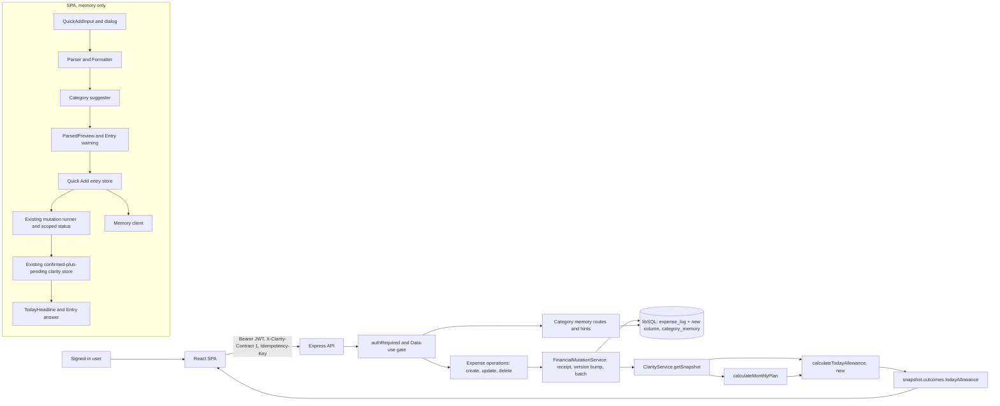
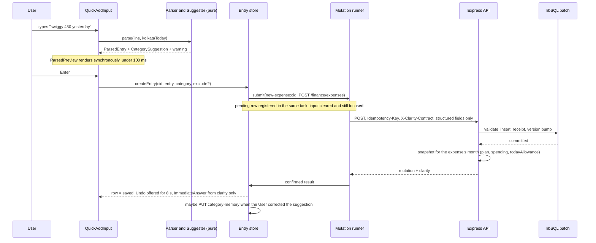
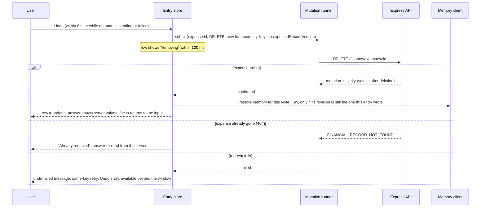
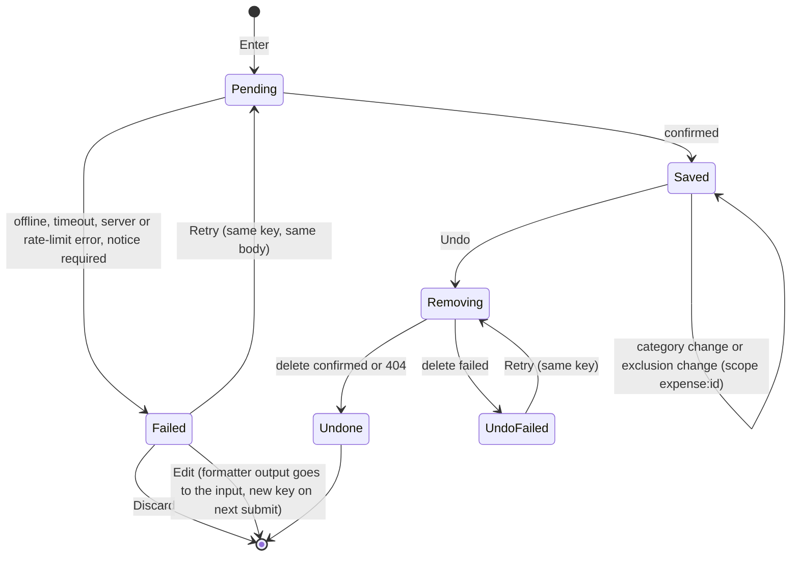

# Quick Add and Daily Answer Design

## Overview

Quick Add and Daily Answer adds one typed entry path, an immediate answer after each save, and a steady "You can spend ₹X today" headline to the clarity Home. It extends the Financial Clarity Experience. It does not add a second way to write expenses and it does not add a second way to calculate money.

The design keeps four boundaries from the existing system:

- **Writes** go through the existing expense create, update, and delete operations (`FinancialMutationService`, `Idempotency-Key`, `X-Clarity-Contract`, receipts, version bump). The only change to those operations is one optional boolean, `excludeFromDailyAllowance`.
- **Money** is calculated on the server in integer paise. The browser formats, compares, and labels. The new "today" values come from a new pure domain module and are returned as one new sibling outcome in the existing snapshot.
- **State** in the browser is memory only. Quick Add entries use the existing mutation runner and scoped status. They add no optimistic money patch, because the browser must not calculate money.
- **Rollback** is a flag flip. Everything added to storage is additive and dormant when the flags are off.

The feature is made of five parts:

| Part | Where it lives | New or reused |
|---|---|---|
| Parser, formatter, category suggester, entry warning, shortcut matcher | Pure TypeScript in the SPA (`frontend/src/clarity/quickAdd/`) | New |
| Today allowance calculation | `backend/src/domain/allowance.js`, exposed as `outcomes.todayAllowance` | New, called by the existing `ClarityService` |
| Expense flag `exclude_from_daily_allowance` | One nullable column on `expense_log`, carried by the existing create and update operations | New column, existing operations |
| Category memory | New table `category_memory`, new routes under `/api/finance`, one hints read | New |
| Quick Add and headline UI | `frontend/src/components/quickadd/`, `TodayHeadline`, Settings memory panel | New, mounted in existing `Shell`, `Dashboard`, `Settings`, `Spending` |

### Goals

1. Let a User record an expense by typing one line from any signed-in page and see exactly what will be saved before pressing Enter.
2. Show, within 100 ms of the server response, what the entry means for today and for the month.
3. Keep every money value server-calculated, explainable, and consistent with the existing Daily_Spending_Guide.
4. Keep one large or bill-like entry from making "left today" meaningless, without hiding it from any monthly total.
5. Make the whole feature switchable and reversible without data loss.

### Non-goals

- No change to the Daily_Spending_Guide, the monthly review, the logging streak, or trip splitting.
- No parsing on the server. The server validates structured fields only.
- No machine learning, no external service, no new background job, no new paid service.
- No offline queue that survives a reload, and no storage of drafts in the browser.
- No per-User thresholds, no automatic exclusion rule other than the mark on an auto-posted recurring expense, and no recurring expense creation by Quick Add.

### Research Findings From the Existing Repository

| Existing behavior | Evidence | Design consequence |
|---|---|---|
| Expense create, update, and delete are `FinancialMutationService` operation handlers. The contract path of `POST /finance/expenses` and the only path of `PATCH` and contract `DELETE` return `mutation` plus the snapshot of the expense's month. | `backend/src/services/expenseMutations.js`, `backend/src/routes/finance.js`, `backend/src/services/financialMutation.js` | Reuse all three. Add one optional field to the create and update normalizers and one SQL assignment. Add no handler. |
| The snapshot is built by `ClarityService.#buildSnapshot`. Outcomes are built with `createDependentOutcome`, so a missing or invalid source marks only dependent outcomes and a calculation failure stays inside one outcome. Explanations are stored by outcome ID. | `backend/src/services/clarityService.js`, `backend/src/domain/outcomes.js` | Add `todayAllowance` as a sibling outcome with its own ID, status, explanation, and failure isolation. Do not add fields to `spending`. |
| `calculateMonthlyPlan` computes `remainingSpendableMinor` and `dailySpendingGuideMinor = divideHalfUp(remaining, daysRemainingInclusive)`. The period comes from Asia/Kolkata. | `backend/src/domain/monthlyPlan.js`, `backend/src/domain/money.js` | Today_Allowance uses the same inputs and `divideHalfUp`, so it equals the guide when nothing is spent today. |
| Expense records loaded for a period carry `spentOn`, `createdAt`, and `amountMinor`. A legacy row can have a null `spent_on`. | `backend/src/repositories/financialRepository.js` | The calculator needs no new query. It reads the same records and adds one field. A null `spent_on` falls back to the Asia/Kolkata date of `created_at`. |
| The mutation response snapshot is computed after commit with the request clock. A delete of a missing record answers 404 `FINANCIAL_RECORD_NOT_FOUND`. A replayed key returns the same `changeId`. | `financialMutation.js` | Entry_Answer is built from the response alone. "Already removed" on undo is the 404. Same-key retry is safe. |
| The legacy `POST /finance/expenses` (no contract header) validates with express-validator and ignores unknown body fields. `PATCH` has no legacy path. | `routes/finance.js` | The new field exists only on the contract path. Quick Add always sends the contract header. |
| The SPA `request()` has no timeout. `clarityApi.mutate` forces the contract header and the schema version check. | `frontend/src/api.ts` | Add an optional per-request timeout (60 s) for Quick Add commands so "timed out" becomes a failed entry with same-key retry. |
| The mutation runner registers pending status synchronously, serializes one in-flight command per scope, retries with the same key, and mirrors confirmed snapshots into the query cache. | `frontend/src/clarity/mutationStatusStore.ts`, `MutationStatusProvider.tsx` | Quick Add entries are runner commands with scope `new-expense:<cid>`, then `expense:<id>`. No second state machine for money. |
| The Spending page keeps its list in local state (`useExpenseList`), not in the query cache. | `frontend/src/components/spending/useSpendingChanges.ts` | Add a small change bus so a Quick Add confirmation updates every mounted view (Requirement 7.17). |
| The Spending page and `currentMonth()` read the device clock. The expense API defaults the date from Asia/Kolkata. | `frontend/src/money.ts`, `useSpendingChanges.ts` | Add a Kolkata calendar helper corrected by server time. Use it for Home, Quick Add, and, while the clarity flag is on, for `currentMonth()`. |
| `Shell` shows `bottom-tabs` below 900 px, hides the header navigation there, and publishes `--bottom-nav-h`. Toasts sit bottom-right above the tab bar. `Modal` handles Escape, Tab wrap, scroll lock, and focus restore. | `frontend/src/components/Shell.tsx`, `ui.tsx`, `styles.css` | Floating_Action and the dialog fit this layout. Toasts move up by the floating action's height. The dialog reuses `Modal`. |
| The data-use notice has one current version. A PATCH must acknowledge exactly that version. Gates default to the current version. | `backend/src/services/claritySettings.js`, `middleware/dataUse.js` | Introduce version 2 (adds category memory) selected by a server flag, so the notice changes only when the feature is switched on. |
| Export reads `SELECT * FROM expense_log`. The CSV export has a fixed header. Account deletion lists every user-linked table and probes each one. | `routes/auth.js`, `routes/finance.js`, `db/accountDeletion.js` | The new column is exported by `SELECT *`. Add the memory table to export, deletion, and probes. Append one CSV column. |
| The only rate limit on API routes is the global 120 requests per minute per IP. The JSON body limit is 64 KB. | `backend/src/app.js` | The Memory_API inherits both ("same limits as finance mutations"). It adds a 1 KB body check. |
| The backend and frontend deploy as separate Render services with separate `rootDir` values. There is no shared package. | `render.yaml` | Do not share source between them. The parser stays in the SPA. The 10-line Note_Key normalizer is duplicated and guarded by a shared fixture test. |
| `materializeRecurring(userId)` in `routes/finance.js` runs on `GET /plan`, `/expenses`, `/insights`, and `/recurring` and after a recurring definition is created. It claims the month through a conditional `UPDATE ... last_logged_month`, then inserts one `expense_log` row with `spent_on` set to the due day, which can be Today. It uses the process clock and no Idempotency-Key. | `backend/src/routes/finance.js`, test `correcting and deleting a materialized recurring expense cannot materialize it twice` in `backend/test/api/expenseMutations.test.js` | The insert statement gains the column `exclude_from_daily_allowance` with the value 1. The claim, the date logic, the clock, and the other columns are untouched, so the existing test expectations hold. A later `PATCH` that sends only an amount does not touch the mark. |
| The Large_Entry percentage and floor are computed on the server, and the Bill_Match label length is applied in the browser. | `backend/src/domain/allowance.js`, `frontend/src/clarity/quickAdd/warning.ts` | One named-constant module per runtime holds these values. No other file repeats the literals. |

### Key Design Decisions

1. **One write path.** Quick Add saves with `POST /finance/expenses`, corrects with `PATCH /finance/expenses/:id`, and undoes with `DELETE /finance/expenses/:id`. The exclusion mark is a field of the first two.
2. **Today values are a sibling outcome.** `outcomes.todayAllowance` has its own status, explanation, and failure isolation. Old servers omit it, and the Home headline treats that as "unavailable" while saving still works (Requirement 16.7).
3. **Exclusion changes only the today view.** An excluded expense dated Today reduces `Remaining_Spendable` like any other expense, so it lowers Today_Allowance exactly as an expense on another day would. It is left out of `Today_Spent` only. This is the precise meaning of "not counted against today" (Requirement 18.12 and 18.13).
4. **The server provides every number the browser compares.** The Large_Entry_Threshold, the progress fraction, the over-today amount, and the excluded total are server values. The browser only compares integers and formats.
5. **The parser lives in the SPA only.** The server never sees the typed line. Parsing in two places would create two grammars to keep equal. Only `normalizeNoteKey` is needed on both sides, so it is duplicated and tested against one fixture file.
6. **Memory writes are not financial mutations.** They return no snapshot and need no receipt, so they use a small client with per-entry status instead of the mutation runner. The upsert is idempotent by state, so retry needs no key.
7. **Undo restores memory by compensation.** The client keeps what the entry changed and reverses it with a revision check, so it never overwrites a newer change.
8. **One feature switch with a client half and a server half.** The owner confirmed that one switch is enough, and Quick Add and the Home headline ship together. The client flag `VITE_QUICK_ADD_ENABLED` removes the UI. The server flag `QUICK_ADD_ENABLED` stops memory writes and selects the data-use notice version. Release turns on the server half first and the client half second. Rollback can flip either half without the other.
9. **Kolkata calendar everywhere.** "Today" and the Home month come from Asia/Kolkata, using the device clock corrected by the `generatedAt` time of the latest server response. While the Rollout_Flag is on, `currentMonth()` uses the same calendar, so Home, Plan, Spending, Goals, and Trips name one month (Requirement 11.22).
10. **Thresholds are named constants.** The Large_Entry percentage (25), the Large_Entry floor (100,000 paise), and the Bill_Match minimum label length (3) each live in one module of the runtime that uses them (Requirement 18.26).
11. **Auto-posted recurring expenses carry the mark from the start.** `materializeRecurring` writes `exclude_from_daily_allowance = 1` in the same insert (Requirement 18.23). A rent or subscription that falls due today therefore lowers today's allowance through Remaining_Spendable and does not appear as today's spending. The change is one extra column and value in one statement. It is written regardless of the three flags, because it alters no amount, total, or projection, and because gating it would leave rows posted before the flag was switched on unmarked. Rows posted before this feature stay unmarked, since the migration backfills nothing (Requirement 16.6).

## Architecture

### System Context



### Reuse Map

| Capability | Reused module | Change |
|---|---|---|
| Expense writes, idempotency, receipts, version bump | `expenseMutations.js`, `financialMutation.js`, `financial_record_changes` | Normalizers accept `excludeFromDailyAllowance`. `update` maps it to the column. `expenseRecordFromRow` returns it. |
| Snapshot, outcomes, failure isolation | `clarityService.js`, `outcomes.js` | New outcome builder call for `todayAllowance`. Add `today_allowance` to outcome kinds. |
| Explanations | `GET /finance/explanations/:outcomeId` | Accept `today-allowance:YYYY-MM` in the route pattern and in `explanationMonth`. |
| Clarity read cache and newest-wins rule | `useClaritySnapshotQuery`, `setFinancialSnapshot`, `selectNewestSnapshot` | None. |
| Confirmed plus pending store | `clarityStore`, `patchReducer`, `FinancialClarityProvider` | None. Quick Add registers no patch. |
| Mutation runner and scoped status | `mutationStatusStore`, `MutationStatusProvider` | Add optional `timeoutMs` to a command and pass it to the request. |
| Data-use gate | `DataUseGateProvider`, `createDataUseNoticeGate`, `claritySettings` | Flag-aware current notice version. Gate memory writes. |
| Feature flags | `rollout/featureFlags.js`, `clarity/rollout.ts` | Add `quickAddEnabled` on the server and `readQuickAddFlag` in the SPA. |
| Measurement | `useMeasurement().financialChangeUi` | Call it after each confirmed save, category change, and undo. No new event. |
| Export, deletion, probes | `routes/auth.js`, `db/accountDeletion.js` | Add `category_memory`. CSV gains one final column. |
| Recurring auto-post | `materializeRecurring` in `routes/finance.js` | One added column and value in its insert statement (see Recurring Auto-Post Mark). |
| Operational logging | `observability/operationalLog.js` | Add the record type `category_memory`. No new field. |
| Modal, toasts, focus, live regions | `components/ui.tsx`, `ToastProvider`, clarity `focus.ts` | Dialog uses `Modal`. Toast stack offsets for the floating action. |

### Backend Layering and Proposed Files

```text
backend/src/
  domain/
    allowance.js            NEW  pure: Today_Spent, Today_Allowance, Left_Today, threshold, progress, explanation steps
                                 exports the named constants LARGE_ENTRY_PERCENT (25) and LARGE_ENTRY_FLOOR_MINOR (100000), the only place these literals appear
    noteKey.js              NEW  pure: normalizeNoteKey (duplicated client rule)
    kolkataTime.js          NEW  pure: fixed +05:30 conversions for created_at fallback
    expenses.js             unchanged (normalizeExpense already passes extra fields through)
  services/
    expenseMutations.js     CHG  create/update normalizers, SQL assignment, record mapper and its row SELECT lists, accepted constraints
    clarityService.js       CHG  build todayAllowance outcome and explanation; period-outcome ID pattern
    categoryMemory.js       NEW  list, upsert with cap and revision check, delete, delete all, history query
    claritySettings.js      CHG  notice version depends on the server flag; add category_memory notice category
  repositories/
    financialRepository.js  CHG  select and map exclude_from_daily_allowance
  routes/
    quickAdd.js             NEW  GET quick-add/hints, PUT/DELETE category-memory (behind authRequired)
    finance.js              CHG  expense list column, CSV column, custom-category delete cascade to memory, materializeRecurring inserts the mark
    clarity.js              CHG  explanation ID pattern
    auth.js                 CHG  export table and description
  db/
    index.js                CHG  addColumnIfMissing + CREATE TABLE IF NOT EXISTS category_memory
    accountDeletion.js      CHG  delete statement, probe, description
  rollout/featureFlags.js   CHG  quickAddEnabled
```

The domain modules have no database, Express, clock, or network dependency. Dates and records are inputs. `allowance.js` receives the already-calculated monthly plan, so it cannot disagree with the guide.

### Today_Allowance Computation

`calculateTodayAllowance({ month, localDate, plan, expenses })` runs only when `month` equals the Asia/Kolkata month of the request instant. `ClarityService` decides that and passes `localDate`.

**Inputs.** `plan` is the result of `calculateMonthlyPlan` for the same month and date: `spendableBudgetMinor`, `remainingSpendableMinor`, `period.daysRemainingInclusive`, `dailySpendingGuideMinor`. `expenses` are the month's normalized records with `id`, `amountMinor`, `spentOn`, `createdAt`, and `excludeFromDailyAllowance` (boolean).

**Attribution.** `effectiveDate(expense) = spentOn ?? kolkataDateOf(createdAt)`. `kolkataDateOf` adds the fixed offset of 19,800 seconds to the UTC timestamp. Asia/Kolkata has had no daylight saving since 1945, so fixed arithmetic is exact and keeps the domain free of `Intl`. A record with no `spentOn` and an unparseable `createdAt` is attributed to no day, so it is never counted today.

**Formulas** (all values integer paise):

```text
counted(e)        = effectiveDate(e) == localDate AND NOT e.excludeFromDailyAllowance
todaySpent        = sum(e.amount for counted e)
excludedToday     = { count, total } of e with effectiveDate == localDate AND e.excludeFromDailyAllowance
allowanceBasis    = remainingSpendable + todaySpent                 (may be negative)
todayAllowance    = allowanceBasis > 0 ? divideHalfUp(allowanceBasis, daysRemainingInclusive) : 0
leftToday         = todayAllowance - todaySpent                     (may be negative)
overToday         = max(0, -leftToday)
usedPermille      = todayAllowance > 0 ? min(1000, halfUpRatio(todaySpent * 1000, todayAllowance)) : null
largeEntryThreshold = spendableBudget > 0 ? max(halfUpRatio(spendableBudget * LARGE_ENTRY_PERCENT, 100), LARGE_ENTRY_FLOOR_MINOR) : null
```

`halfUpRatio` uses `BigInt` so `todaySpent * 1000` cannot exceed the safe integer range. `divideHalfUp` is the existing function. For a positive dividend it rounds half-paise upward, which is the required rule. A non-positive basis is floored to zero before any division.

**Zero reasons.** `zeroReason` is `no_spendable_budget` when `spendableBudgetMinor` is 0 (bills equal or exceed pay), `month_budget_used` when `allowanceBasis <= 0` (with `usedBeyondBudget = max(0, -allowanceBasis)`), and `below_minimum_unit` when the basis is positive but rounds to zero.

**Edge cases.**

| Case | Result |
|---|---|
| Nothing counted today, guide not negative | `todayAllowance == dailySpendingGuide` (Requirement 10.7) |
| Last day of month | `daysRemainingInclusive = 1`, so allowance equals the whole basis |
| First day of month | `daysRemainingInclusive = daysInMonth` |
| Excluded expense dated Today | Lowers `remainingSpendable` and so the allowance, exactly like the same expense on another day. Not in `todaySpent`. |
| Expense dated later this month | Lowers `remainingSpendable`, so it spreads over the remaining days including today |
| Expense dated another month | Not loaded for this period, so no effect (Requirement 10.10) |
| Requested month is not the current month | `value = { applicable: false, reason: "not_current_month" }`, no explanation (Requirement 10.16) |
| Legacy expense with null `spent_on` | Attributed to the Kolkata date of `created_at` (Requirement 10.2) |
| Recurring expense auto-posted with `spent_on` Today | Carries the mark from its insert, so it lowers `remainingSpendable` and the allowance like any other expense and is listed in `excludedToday`, not in `todaySpent` (Requirement 18.23) |
| Recurring expense auto-posted before this feature | Unmarked, so it is a Counted_Expense if it is dated Today. Nothing is backfilled. |
| Midnight in Asia/Kolkata | The request instant, not the process time zone, selects `localDate` (Requirement 10.15) |
| Missing or invalid plan input | Handled by `createDependentOutcome` with the same dependencies as `spending`. Status becomes `missing_input` or `invalid_input`. |

**Explanation steps** (order fixed by Requirement 10.18): `today_allowance.spendable_budget` (source), `today_allowance.expenses_used` (sum of all the month's expenses, listing counted and excluded-today separately per Requirement 10.25), `today_allowance.remaining_spendable` (subtract), `today_allowance.add_today_spent` (sum, giving the basis), `today_allowance.divide_days` (divide with `round_half_up` metadata), `today_allowance.floor_zero` (maximum), `today_allowance.subtract_today_spent` (subtract, giving Left_Today), and `today_allowance.versus_guide` (a reference to the guide result so the UI can state the difference in plain language, Requirement 10.19). Source references include one `expense:<id>:excludeFromDailyAllowance` boolean reference for each expense dated Today.

### Snapshot Integration

`ClarityService.#buildSnapshot` builds `todayAllowance` after `monthlyPlan` and `spending`, with the same `dependencies` object, so a missing or invalid salary, bill, or expense marks it `missing_input` or `invalid_input` and unlocks the same corrective inputs. The outcome ID is `today-allowance:<month>` and its retry scope is `outcome:today-allowance:<month>`.

- The month is the current month only when `month === localDateForInstant(now).slice(0, 7)`. For any other month the outcome is `available` with `value = { applicable: false, reason: "not_current_month" }` and no explanation, whatever the plan inputs are.
- `calculate` runs `calculateTodayAllowance` with the `rawMonthlyPlan` that the plan outcome already produced, so the two cannot disagree. An exception inside it becomes `calculation_failed` for this outcome only, and `monthlyPlan` and `spending` keep their values (Requirement 11.10).
- `explanationMonth` and the route pattern in `routes/clarity.js` accept `today-allowance:YYYY-MM`. `GET /finance/explanations/:outcomeId` then serves the explanation like every other period outcome, including `supersededByVersion`.
- The expense operation handlers add `{ key: 'todayAllowance', id: 'today-allowance:<month>', kind: 'today_allowance' }` to `affectedOutcomes` when the snapshot month is the current month, so a failed snapshot after a committed write marks the new outcome `calculation_failed` and the source write stays confirmed.
- `financialRepository.loadPeriod` selects `exclude_from_daily_allowance` and maps it to `excludeFromDailyAllowance` (`value === 1`). `facts` already carries each active bill's label, which the browser uses for Bill_Match.

### Recurring Auto-Post Mark

The owner decided that an expense posted by a recurring definition must not count as spending of the day it falls due. `materializeRecurring` is the only writer of those rows, so the change is made there and nowhere else.

```js
// before
`INSERT INTO expense_log (user_id, month, category, amount, note, spent_on)
 VALUES (?, ?, ?, ?, ?, ?)`
// after: the column list gains the mark and the VALUES list gains the literal 1
`INSERT INTO expense_log (user_id, month, category, amount, note, spent_on, exclude_from_daily_allowance)
 VALUES (?, ?, ?, ?, ?, ?, 1)`
```

- The claim `UPDATE` on `recurring_expenses.last_logged_month`, the clamp to the last day of the month, the use of the process clock, the note text `<label> (recurring)`, and the error logging stay as they are. The `INSERT` is still one statement, so the change adds no query and no failure path.
- The mark is written whatever the three flags are, and the column exists on every deployment because the migration runs at startup. With the flags off nothing reads it except the new always-computed `todayAllowance` outcome, the list column, and the exports, all of which are additive.
- The existing expense update handler assigns the column only when the request carries `excludeFromDailyAllowance`, so the correction in the test `correcting and deleting a materialized recurring expense cannot materialize it twice` (an amount-only `PATCH`) leaves the mark in place. That test asserts the amount, the period, the replay, the ledger count, and `last_logged_month`, and none of them changes.
- A User can clear the mark on the Spending page edit form, which is the existing explicit action (Requirement 18.24). Rows posted before this feature stay unmarked because nothing is backfilled.
- Spending shows "Not counted in daily allowance" beside every auto-posted expense, including those dated on earlier days of the month, where the mark has no effect on the allowance. The text is the same for every marked expense, so a User learns one rule.

### Quick Add Save Flow



The request body is `{ amountMinor, category, note?, spentOn, excludeFromDailyAllowance?: true }`. It never carries the typed line (Requirement 4.5). The client always sends `spentOn`, so the date is the one the User saw in the preview.

### Undo Flow



Undo sends no `expectedRecordVersion`. A category change made during the window (Requirement 8.13) or an edit made on another device therefore cannot block the deletion. The delete targets the numeric ID the create returned, so it can never remove another expense with the same amount, note, and date (Requirement 8.4).

### Entry State Machine



### Client State Architecture

`quickAddStore` is a framework-free store, the same style as `clarityStore` and `mutationStatusStore`. It holds the draft line, the ordered list of entries, the undo deadlines, and the memory status of each entry. It lives in a `QuickAddProvider` mounted inside `FinancialClarityProvider` and `MutationStatusProvider`. Nothing is written to `localStorage`, `sessionStorage`, cookies, or the address (Requirement 7.18). It is reset by `subscribeToFinancialStateClear`, which `clearAuth()` already triggers.

- The draft line lives in the store, so the Home input and the dialog show the same text and a closed dialog keeps its draft until sign-out.
- Each submitted entry becomes a runner command. The runner owns pending, success, and error status and the idempotency key. The store owns what the runner does not: the parsed values, the chosen category, the undo deadline, and the memory status.
- The entry's scope is `new-expense:<cid>` until the create is confirmed and `expense:<id>` afterward. The runner already allows one in-flight command per scope, so a category change and an undo for the same expense cannot overlap.
- No patch is registered. The visible snapshot is the confirmed snapshot. A pending entry appears only as a status row.
- Five pending entries disable submission with a text reason and keep the typed line (Requirement 7.12).
- A confirmed result calls `expenseEvents.publish({ mutation })`. The Spending page list, the logging streak card, and any other mounted view subscribe and apply the change without a refetch (Requirement 7.17).

### Kolkata Calendar

`kolkata.ts` converts an instant to a Kolkata date with the same fixed-offset arithmetic as the backend, and it keeps a server-time offset. After each snapshot or mutation response the client records `offset = Date.parse(generatedAt) - Date.now()`. `kolkataNow()` is `Date.now() + offset`. A device whose clock is hours off still agrees with the server on the day. `useKolkataToday()` re-evaluates every 30 seconds and when the page becomes visible. A change of date or month re-keys the Home snapshot query and marks the old values stale until the re-read returns (Requirement 11.14 and 11.15). While the Rollout_Flag (`VITE_FINANCIAL_CLARITY_ENABLED`) is on, `currentMonth()` in `money.ts` returns the Kolkata month, so Home, Plan, Spending, Goals, and Trips agree with Home and with the server (Requirement 11.22). This depends on the Rollout_Flag only, not on the Quick_Add_Flag, so it stays in effect when Quick Add is switched off, and it changes the month only for a device whose clock month differs from the Kolkata month. With the Rollout_Flag off, `currentMonth()` keeps its device-clock behavior (Requirement 11.23). Pages must call `currentMonth()` or `useKolkataMonth()` at render time and not capture the month in a module constant, so a month rollover re-keys them without a reload.

### Home Layout and Headline

With `Quick_Add_Enabled`, the clarity Home renders in this order. Items 1, 2, and 5 to 7 are the existing Home with its existing components.

1. `CorePromiseStrip` and `DataUseGate` (in `Shell`).
2. `ClarityPageHeader`: the page decision and the highest-ranked action.
3. `TodayHeadline` (new, region `today`): the first Financial_Outcome.
4. `QuickAddPanel variant="inline"` (new): the first primary action, directly below the headline.
5. `QuickActions` tiles. "Add expense" still opens Spending.
6. The monthly summary region, which still shows the existing "Daily spending guide" unchanged.
7. The guided-journey card, streak card, and invites.

`Dashboard` takes its month from `useKolkataMonth()`, so a midnight or month rollover re-keys the snapshot query without a reload. The headline has its own region, so its loading, error, and retry never hide the summary or the Quick Add input, and Quick Add stays interactive before the snapshot or the hints have loaded (Requirement 13.1).

| Headline state | Source | Display |
|---|---|---|
| Loading | Query pending | Size-stable placeholder with a minimum height, inside the region only |
| Available | `todayAllowance.status = available`, `applicable = true` | "You can spend ₹X today" as the largest text, "₹L left today" beside it, "Spent today ₹S" and the date, a progress bar that is `aria-hidden` plus the text "8.9% of today's allowance used" built from `usedPermille` by formatting only, "How this was calculated", and the labels "calculated result" |
| Over | `overToday > 0` | "Over today's allowance by ₹W" in place of "left today", bar at 100 percent |
| Zero | `todayAllowance = 0` | "You can spend ₹0 today", no percentage, and the reason: `month_budget_used` gives "This month's spendable budget was already used before today, by ₹B." from `usedBeyondBudget`; `no_spendable_budget` gives "Your bills use all of your pay this month."; `below_minimum_unit` gives "What is left is less than ₹0.01 a day." |
| Marked entries | `excludedToday.count > 0` | A line such as "1 expense not counted today (₹1,200)" |
| Missing pay | `monthlyPlan` or `todayAllowance` is `missing_input` | "Add this month's pay to see what you can spend today" with a link to the Plan pay form |
| Invalid input | `invalid_input` | Names the input, the accepted constraint, and the affected outcome |
| Calculation failed | `calculation_failed` | "Temporarily unavailable" and one retry that re-reads the snapshot. Confirmed inputs stay. |
| Server without the field | `todayAllowance` absent for the Current_Month | The same unavailable state. Saves and the monthly answer still work. |
| Stale | `period.asOfDate` differs from the Kolkata date | Values marked stale, re-read within 60 seconds, and again when the page becomes visible |
| Region error | Query error | Error and retry inside the region. Other regions stay. |

An open explanation stays open while the values update, because it subscribes to `dataVersion` like every other explanation.

### Rollout and Rollback

| Flag | Where | Default | Effect |
|---|---|---|---|
| `VITE_FINANCIAL_CLARITY_ENABLED` | SPA build | off | Existing. Selects the clarity experience. |
| `VITE_QUICK_ADD_ENABLED` | SPA build | off | Quick Add surfaces, Home_Headline, exclusion text and control, memory panel. Has no effect while the clarity flag is off. One flag covers Quick Add and the headline together. |
| `QUICK_ADD_ENABLED` | API environment (read through `readBooleanFeatureFlag`) | off | Enables memory writes and selects data-use notice version 2. Reads, deletes, the hints read, the expense field, and the `todayAllowance` outcome do not depend on it. |

Rollout order:

1. **Characterize.** Add tests around the current expense routes, snapshot shape, export, and deletion before changing them.
2. **Backend, both server flags off.** Deploy the migration, the expense field, the mark on auto-posted recurring expenses, the `todayAllowance` outcome (always computed, failure-isolated), the memory table and routes (writes answer 404 `QUICK_ADD_DISABLED`), and the CSV column. No visible change.
3. **SPA, both client flags off.** Deploy all new code. The rollout matrix tests show no new request and no new element.
4. **Server flag on.** Memory writes work. Users of the clarity experience see notice version 2 once.
5. **Client flag on.** Quick Add and the headline appear. Watch the existing measurement reports (reload and page-wide loading rates stay at zero) and the redacted request logs.

Rollback, in order of speed:

- **Server flag off.** Memory writes stop, notice version returns to 1, and users who acknowledged version 2 are not asked again (their stored version is not below 1). The SPA treats the 404 as "memory unavailable" and keeps saving entries (Requirement 16.8).
- **Client flag off, static rebuild.** Every surface disappears. The next page load is the clarity Home as it was. Unsent drafts are lost with the page. Entries whose requests were sent are safe on the server and replay-safe.
- **Nothing is deleted or rewritten.** Saved expenses, exclusion marks (including the marks on auto-posted recurring expenses, which stay because they hold no amount), and memory rows stay. Monthly totals, the guide, exports, the monthly review, and the streak count every expense whether or not it is marked, so they are identical before and after (Requirement 16.14). Turning the flags back on shows everything again with no migration step (Requirement 16.15).

### Free-Plan Constraints

| Constraint | Handling |
|---|---|
| The free API host sleeps and wakes in 30 to 60 seconds | Entry is pending without resend after 5 seconds with the "server may be waking up" text. The command times out at 60 seconds and becomes a failed entry with same-key retry. |
| No paid service, worker, or scheduled job | None added. History is computed on request. Memory eviction runs inside the upsert batch. |
| Turso and SQLite read quotas | The snapshot adds no query. The hints read runs once per page load and reads at most 5,000 rows through the existing `(user_id, month)` index. |
| Request volume | At most one expense write and one memory write per entry, at most five pending entries, no polling. The global limit of 120 requests per minute per IP is not approached. |

### Security, Privacy, and Logging

- Every new route sits behind `authRequired`, filters by `user_id`, and answers a missing or foreign record with the same 404. The route inventory test must find `authRequired` in front of each new route.
- Request bodies are closed schemas. An unknown property is rejected. Strings are bound as SQL parameters and never interpreted.
- The Quick Add client calls only the Expense_API and the Memory_API. There is no third-party or AI call. The typed line stays in the browser.
- Server logs go through the existing allowlisted `operationalLog`. They carry event code, route pattern, status, duration bucket, and record IDs. They never carry an amount, note, Note_Key, or category.
- The browser writes no entry value to the console or storage. Every note, category name, and reason renders as a React text node. No `dangerouslySetInnerHTML`.
- The input sets `autocomplete="off"`, `autocorrect="off"`, `autocapitalize="none"`, and `spellcheck="false"`, so typed financial notes are not sent to a keyboard dictionary service where the platform honors those attributes.
- The CSV export keeps the existing formula-injection guard, and the new column holds only `yes` or `no`.
- Category memory is never included in public trip links, administrator summaries, or Product Analytics.

### Performance Budget

| Interaction | Budget | How it is met |
|---|---|---|
| Preview after a keystroke | 100 ms (Requirement 3.1) | Synchronous pure functions on at most 200 characters. Parsing is linear. The suggester checks a fixed rule list. No debounce and no network. |
| Pending row after Enter | 100 ms (Requirement 7.2) | The runner registers the status in the same task as the click handler. |
| Answer after a response | 100 ms (Requirement 7.6) | `setFinancialSnapshot` and the store update run before any toast work. The answer is a pure function of the response. |
| Added server work per snapshot | One pass over the month's expenses | No new query. The cost is linear in the month's expense count. |
| Added bundle size | At most 30 KB gzip in total | No new dependency. The panel is not lazy-loaded, so the first shortcut press has no chunk-load delay. The build report is checked in review. |
| Hints read | Once per page load | Query key `['quick-add','hints']` with `staleTime: Infinity`. After a memory change or a confirmed entry the cache is updated in place, not refetched. |

## Components and Interfaces

### Frontend Components

| Component or module | Responsibility | Integration point |
|---|---|---|
| `QuickAddProvider` | Holds the entry store, hints query, memory client, announcer, and the open state of the dialog. | Mounted in `Shell` inside the existing providers. Renders nothing when `Quick_Add_Enabled` is false. |
| `QuickAddPanel` | One implementation of input, preview, warning, status list, and answer. `variant` is `inline` or `dialog`. | Home (inline) and `QuickAddDialog` (dialog). |
| `QuickAddInput` | Single-line text field with visible label, `aria-describedby` for accepted forms with examples, shortcut hint text, and Enter handling. | Inside `QuickAddPanel`. |
| `ParsedPreview` | Shows amount, category with reason and "Default" label, full date with "Today" or "Future date", month the entry counts toward, note or "No note", and Parse_Problems as text. | Inside `QuickAddPanel`. |
| `EntryWarning` | Shows the bill or large-amount text and the two save buttons. | Inside `ParsedPreview`. |
| `CategoryChoice` | Native `<select>` of every available category, plus "Forget this" when the source is memory. | Inside `ParsedPreview` and `EntryStatusRow`. |
| `EntryStatusRow` | One entry: pending, saved, failed, removing, undone, undo failed. Hosts Undo, Retry, Edit, Discard, category change, exclusion toggle, and memory retry. | `EntryStatusList`. |
| `ImmediateAnswer` | Renders the Entry_Answer for the most recently confirmed entry. | Below the status list. |
| `UndoToast` | An Undo control in the toast stack for an entry inside its window when no Quick Add surface is mounted. | Toast region in `Shell`. |
| `QuickAddDialog` | `Modal` that wraps `QuickAddPanel variant="dialog"`, focuses the input on open, and returns focus on close. | Opened by the floating action and the shortcut. |
| `QuickAddFab` | 48 by 48 px floating action. Fixed bottom-right above the tab bar and safe area. | `Shell`, below 900 px, user view only. |
| `QuickAddShortcutHost` | Installs the single `keydown` listener and calls `matchQuickAddShortcut`. | `Shell`, user view only. |
| `TodayHeadline` | "You can spend ₹X today", "left today", spent, progress, excluded note, explanation, and all failure states. | `Dashboard` (clarity), first outcome. |
| `CategoryMemoryPanel` | Lists memory entries with delete one and delete all. | `Settings`, while `Quick_Add_Enabled`. |
| `ExpenseRows` (changed) | Shows "Not counted in daily allowance" and a checkbox in the edit form. `spendingInputs.ts` maps the new column and sends the field only when it changed. | Spending, while `Quick_Add_Enabled`. |

Logic modules in `frontend/src/clarity/quickAdd/`:

| Module | Contents |
|---|---|
| `parser.ts` | `parseQuickAddLine(line, today)` returns `ParseResult`. |
| `amount.ts` | Amount grammar, Indian and Western grouping rules, paise conversion, and `formatInr`. |
| `dates.ts` | Calendar helpers and day-only date resolution. |
| `formatter.ts` | `formatQuickAddLine(entry)`. |
| `noteKey.ts` | `normalizeNoteKey(text)`. |
| `suggester.ts`, `keywordRules.ts` | `suggestCategory(input)` and the frozen rule list. |
| `warning.ts` | `classifyEntryWarning(entry, billKeys, threshold)`. |
| `shortcut.ts` | `matchQuickAddShortcut(event, platform)`, `isApplePlatform()`. |
| `kolkata.ts` | `kolkataToday`, `kolkataMonth`, `observeServerTime`, `useKolkataToday`. |
| `answer.ts` | `buildEntryAnswer(envelope, entry, today)` returns a structured model of text keys and money references. |
| `quickAddStore.ts` | Entry store, undo timers, memory status, announcements. |
| `useQuickAddActions.ts` | `submit`, `retry`, `edit`, `discard`, `undo`, `changeCategory`, `setExclusion`, `forgetMemory`, `recalculate`. |
| `memoryClient.ts` | Hints read and memory writes with the status of each. |
| `expenseEvents.ts` | Publish and subscribe for confirmed expense changes. |

### Parser Specification

The Quick_Add_Parser is a pure function `parseQuickAddLine(line: string, today: string): ParseResult` where `today` is `YYYY-MM-DD` in Asia/Kolkata. It reads no clock, locale, storage, network, or time zone. It never throws.

**Result types.**

```ts
type ParseResult =
  | { ok: true; entry: ParsedEntry }
  | { ok: false; problems: ParseProblem[] };       // never empty

interface ParsedEntry {
  amountMinor: number;      // positive safe integer, at most 9_999_999_999_999
  spentOn: string;          // YYYY-MM-DD, real date inside the accepted range
  note: string;             // as typed, whitespace collapsed, trimmed, may be ''
}

interface ParseProblem {
  code: 'LINE_TOO_LONG' | 'MISSING_AMOUNT' | 'INVALID_AMOUNT' | 'MULTIPLE_AMOUNTS'
      | 'INVALID_DATE' | 'MULTIPLE_DATES' | 'NOTE_TOO_LONG';
  subcode?: 'BAD_GROUPING' | 'TOO_MANY_DECIMALS' | 'NO_INTEGER_PART' | 'TRAILING_POINT'
      | 'ZERO' | 'TOO_LARGE' | 'NOT_A_DATE' | 'OUT_OF_RANGE';
  part: string;             // the affected text exactly as typed, or '' for the whole line
  reason: string;           // plain sentence
  correction: string;       // plain sentence stating an accepted form
}
```

**Algorithm.** Each stage is a single left-to-right pass over at most 200 characters, so the whole parse is linear.

1. **Length.** If `line.length > 200` (UTF-16 code units), return `LINE_TOO_LONG` and stop. This is the only early exit.
2. **Quoted segments.** Scan for an ASCII `"` that has a later closing `"`. A doubled `""` inside is one literal quote. The enclosed text becomes one `QUOTED` segment, never interpreted. A `"` with no closing quote is ordinary text. Curly quotes are not delimiters. The input sets `autocorrect="off"` so mobile keyboards do not replace typed quotes.
3. **Tokens.** Split the rest on `\s+`. Zero-width joiner and non-joiner are not whitespace, because Devanagari and Telugu shaping needs them.
4. **Classify each token** by `t = token.normalize('NFKC')`, keeping `token` for the note:
   1. **Date words**: `today`, `yesterday`, the seven full weekday names (letter case ignored).
   2. **`on N`**: the token `on` followed by a token `^\d{1,2}(st|nd|rd|th)?$`. Both tokens are consumed. If the integer is greater than 31 the pair is not a date. `on` stays a note word and the integer becomes an amount candidate. An integer of 0 is `INVALID_DATE`.
   3. **Ordinal**: `^\d{1,2}(st|nd|rd|th)$`.
   4. **Slash dates**: `^(\d{1,2})/(\d{1,2})$`, `^(\d{1,2})/(\d{1,2})/(\d{2}|\d{4})$` (day first), and `^\d{4}-\d{2}-\d{2}$`. Any other token containing `/` is a note word.
   5. **Currency marker** tokens `₹`, `rs`, `rs.`, `inr` (letter case ignored). A marker attaches to the next token if that token is an amount candidate. A marker alone is a note word.
   6. **Amount candidate**: after removing an attached prefix marker and an optional `/-` suffix, the body matches `^[0-9,]*(\.[0-9]*)?$` and contains at least one digit. `Rs120`, `₹120`, `INR120`, `500/-`, and `₹1,20,000/-` are candidates.
   7. **Mixed tokens** such as `7up`, `route66`, `3pm`, and `120rs` are note words (digits and letters together).
   8. Everything else is a note word.
5. **Resolve the date.** Zero date tokens: `today`. More than one: `MULTIPLE_DATES` listing them. Otherwise resolve as below.
6. **Resolve the amount.** Remove date tokens first (so `on 3` and `3rd` are not amounts). One candidate: use it. Several with exactly one carrying a marker: use the marked one and keep the others as note words. Several otherwise: `MULTIPLE_AMOUNTS` listing them. None: `MISSING_AMOUNT`.
7. **Validate the amount candidate.**
   - Integer part `^\d+$`, or Indian grouping `^\d{1,2}(,\d{2})*,\d{3}$`, or Western grouping `^\d{1,3}(,\d{3})+$`. Anything else is `BAD_GROUPING`. A trailing comma (`120,`) is also `BAD_GROUPING`.
   - No digit before the point is `NO_INTEGER_PART`. A point with no digits after it is `TRAILING_POINT`. More than two fractional digits is `TOO_MANY_DECIMALS`. The value is never rounded or truncated.
   - One fractional digit means tenths: `120.5` is 12,050 paise.
   - More than 11 integer digits is `TOO_LARGE`. A value of zero is `ZERO`. Both state the range ₹0.01 to ₹99,99,99,99,999.99.
   - `amountMinor = integerDigits * 100 + fraction`, built from the digit string so no floating-point step exists.
8. **Note.** Join the unclaimed token texts and quoted segment contents in line order with single spaces and trim. If it is longer than 120 UTF-16 code units, return `NOTE_TOO_LONG`, because the Expense_API counts the same unit.
9. **Result.** Collect every problem from steps 5 to 8 so the User can fix them together. If none, return the entry.

**Day-only and relative dates.** All rules resolve to the latest matching date on or before `today`. A weekday equal to today's weekday resolves to today.

| Token | Resolution |
|---|---|
| `today`, `yesterday` | `today` or `today - 1` |
| weekday name | the latest date on or before `today` with that weekday |
| `on N`, `Nth` | the latest date on or before `today` whose day of month is `N`, skipping months that have no day `N` (31 skips 30-day months) |
| `dd/mm` | the latest date on or before `today` with that day and month. 29 February resolves to the latest leap day. |
| `dd/mm/yy`, `dd/mm/yyyy`, `yyyy-mm-dd` | exactly that date. A two-digit year is `20yy`. |

A token that names no real date (`31/02`, `0th`, `32nd`, `12/25`) is `INVALID_DATE / NOT_A_DATE` and names the token. The parser never reads `12/25` as month first. A date outside January 1 of `today.year - 10` through December 31 of `today.year + 1` is `INVALID_DATE / OUT_OF_RANGE` and states the range.

**Precedence, in one table.**

| Rule | Wins over |
|---|---|
| Quoted text | every other interpretation |
| Date patterns (4.1 to 4.4) | amount candidates |
| `on` followed by a number above 31 | date (the number becomes an amount) |
| A marked amount candidate | unmarked candidates |
| Digits mixed with letters | amount candidate |
| Anything left | note |

**Error taxonomy.**

| Code | Trigger | Text names |
|---|---|---|
| `LINE_TOO_LONG` | more than 200 UTF-16 units | the length and 200 |
| `MISSING_AMOUNT` | no amount candidate left | an accepted form such as `120 coffee` |
| `INVALID_AMOUNT` | grouping, decimals, zero, size | the token and the accepted range or form |
| `MULTIPLE_AMOUNTS` | several unmarked candidates | the candidates and "mark the amount with ₹" |
| `INVALID_DATE` | not a real date or out of range | the token and the accepted range |
| `MULTIPLE_DATES` | more than one date token | the tokens |
| `NOTE_TOO_LONG` | note over 120 units | the length and 120 |

Numerals follow decision 7. The parser reads only ASCII digits `0` to `9` after NFKC, so fullwidth digits are accepted and Devanagari, Telugu, and Arabic-Indic digits remain note text. Currency markers, date words, weekday names, `on`, and ordinal suffixes are English ASCII only.

### Formatter Specification

`formatQuickAddLine(entry)` returns `₹<amount> <yyyy-mm-dd>` followed by `"<note>"` when the note is not empty. The amount uses Indian grouping with two fractional digits only when paise are present. A literal `"` in the note is written as `""`. Because the note is quoted, a note that looks like an amount or a date round-trips as a note. The Edit action uses this output to refill the input (Requirement 7.10).

### Category Suggestion

`suggestCategory({ note, categories, memory, history, rules })` returns exactly one `CategorySuggestion = { category, source, reason }`. It has no randomness, clock, or network access. `categories` is the list the User can use now (ten built-in categories plus custom ones). The first rule that applies wins.

1. **Empty note.** `Other`, source `default`, reason "No note, so this goes to Other."
2. **Memory.** If `noteKey(note)` equals a memory key exactly and the category is available: that category, source `memory`, reason `You corrected "{note}" to {category} before.`
3. **History.** If the key equals a history key and the category is available: the category of the most recent such expense in the last 90 days, source `history`, reason `Your last "{note}" expense was in {category}.`
4. **Category name.** If a whole word or phrase of the note equals an available category name (letter case ignored): that category. If several match, the longest name wins, then built-in before custom, then custom by creation order. Source `category_name`, reason `"{words}" is one of your categories.`
5. **Keyword.** Match the frozen rule list against the note's tokens. The longest phrase wins. Equal lengths go to the earlier rule. Source `keyword`, reason `"{words}" usually means {category}.`
6. **Default.** `Other`, source `default`, reason "No match found, so this goes to Other."

Whole-word matching splits the lowercased NFKC note on anything that is not a Unicode letter or number, so `swiggy,` matches `swiggy` and `grocery` does not match inside `grocerystore`. Memory and history use the exact `Note_Key` only (Requirement 5.16). A note in Hindi or Telugu matches only the memory, history, and category-name sources, because rule words and custom category names are ASCII. An unavailable category (for example a deleted custom category named in a stale hint) is skipped, and the next rule is tried. A note longer than 60 code points has no `Note_Key`, so it skips memory and history.

The initial rule list below is data in `keywordRules.ts`. Rules map to built-in categories only (Requirement 5.13). The first rule in this order wins an equal-length tie, so more specific categories come first. The list is expected to grow through ordinary changes, each with a test.

| Category | Words and phrases |
|---|---|
| Groceries | grocery, groceries, vegetables, veggies, fruits, milk, eggs, bread, bigbasket, blinkit, zepto, dmart, kirana, supermarket |
| Food | coffee, tea, chai, lunch, dinner, breakfast, snack, snacks, swiggy, zomato, restaurant, cafe, biryani, pizza, burger, dosa, idli, juice, meal, eating out |
| Transport | uber, ola, rapido, cab, taxi, auto, metro, bus, petrol, diesel, fuel, parking, toll, fastag |
| Travel | flight, hotel, irctc, airbnb, makemytrip, goibibo, holiday, visa |
| Entertainment | movie, movies, netflix, spotify, hotstar, prime video, bookmyshow, concert, gaming, youtube premium |
| Shopping | amazon, flipkart, myntra, ajio, clothes, shoes, shirt, shopping, mall |
| Bills | rent, electricity, water bill, gas, wifi, internet, broadband, recharge, phone bill, mobile bill, emi, insurance, dth, credit card |
| Health | doctor, medicine, medicines, pharmacy, medical, hospital, clinic, dental, gym, lab test |
| Education | course, tuition, school, college, books, udemy, exam, fees |

### Entry Warning Classification

`classifyEntryWarning({ entry, today, billKeys, largeEntryThresholdMinor })` is pure and returns `{ kind: 'none' } | { kind: 'warn', bill?: string, large: boolean }`.

- It returns `none` unless `entry.spentOn === today`. The exclusion has no effect on any other date, so no choice is offered (Requirement 18.8).
- `bill` is the label of the first Active_Bill whose normalized label equals the note's `Note_Key`, or is contained in it as a whole word or phrase (the equality test applies to a label of any length, and the containment test applies only to a label of at least `BILL_MATCH_MIN_LABEL_LENGTH` characters, a named constant of 3 in `warning.ts`, the only place the literal appears). `billKeys` come from `snapshot.facts` entries of type `bill`, so they are the labels of the bills active in the Current_Month. They refresh with every confirmed snapshot.
- `large` is `largeEntryThresholdMinor !== null && entry.amountMinor >= largeEntryThresholdMinor`. The threshold is `outcomes.todayAllowance.value.largeEntryThreshold`, so it is as fresh as the last snapshot. The browser compares two integers and calculates nothing.
- If the snapshot or either input is missing, that cause is skipped and saving is unaffected (Requirement 18.11).

The preview offers "Save and count today" (Enter does the same) and "Save, but don't count against today". For a bill match it adds "Your Plan already includes this bill. Saving it here also counts it as spending this month." The warning never changes the amount, category, note, or date.

### Keyboard Shortcut

`matchQuickAddShortcut(event, platform)` is pure.

```ts
function matchQuickAddShortcut(e: KeyEventLike, apple: boolean): boolean {
  if (e.isComposing || e.repeat || e.shiftKey || e.altKey) return false;
  const modifier = apple ? e.metaKey && !e.ctrlKey : e.ctrlKey && !e.metaKey;
  if (!modifier) return false;
  return /^[a-z]$/i.test(e.key) ? e.key.toLowerCase() === 'k' : e.code === 'KeyK';
}
```

`QuickAddShortcutHost` registers one `window` `keydown` listener while `Quick_Add_Enabled` and a User view is mounted. On a match it also checks that no other `[role="dialog"][aria-modal="true"]` is open (the Quick Add dialog excepted) and that the Data_Use_Gate notice is not showing. Only then does it call `preventDefault()` and open or focus Quick Add.

| Conflict | Handling |
|---|---|
| Browsers use Ctrl + K to focus the search bar (Chrome on Windows and Linux, Firefox) | Pages may override it, unlike Ctrl + T, N, or W. The page overrides it only while Quick Add is enabled and a User view is mounted, so the browser keeps the combination everywhere else. Chrome users keep Ctrl + E for the search bar. The floating action and the Home input never depend on the shortcut. |
| Ctrl + K in a macOS text field kills to end of line | On Apple platforms only Cmd + K matches and Ctrl + K is ignored, so text editing keeps working. |
| Shift or Alt held (Ctrl + Shift + K opens Firefox's web console, AltGr reports Ctrl + Alt) | Ignored. |
| Non-Latin keyboard layouts (Hindi, Telugu) | A Latin letter key is matched by its value. Otherwise the physical key code `KeyK` is matched. |
| Input method composition and key repeat | Ignored. |
| Another modal is open (sign-out feedback, data-use notice) | Ignored, so a modal's focus containment is never broken. |
| Focus is in another text field | Handled. Focus moves to Quick Add and the other field's value is untouched (Requirement 1.9). |
| Quick Add dialog already open | Focus moves to the input. No toggle and no second dialog (Requirement 1.17). |
| Flag off or signed out | The listener is not installed and the browser keeps the key (Requirement 1.18). |

Discoverability: on Home at 900 px and wider the input shows the text "Ctrl K" or "⌘ K" beside it, chosen by platform. The dialog footer shows the same text. The floating action, the Home input, and the dialog trigger carry `aria-keyshortcuts="Control+K"` or `"Meta+K"`. Screen reader and operating-system conflicts are checked by hand on the browser matrix in the testing strategy.

### Accessibility and Responsive Contract

- `QuickAddInput` has a visible `<label>`, and `aria-describedby` points to the accepted forms with examples and to the Entry_Preview. The preview is a text region associated with the input, and it is not live. Typing never announces anything (Requirement 12.2).
- One polite live region announces a confirmed save (amount, category, and either Left_Today or the month), a confirmed undo, and each error once. The store de-duplicates by event key. Pending states are never announced (Requirement 12.3).
- Parse_Problems render as text that names the affected part, the reason, and the correction. They are tied to the input with `aria-describedby` and `aria-invalid`, and announced through the assertive region without moving focus (Requirement 3.9).
- The Entry_Warning is text. Its two buttons are at least 44 by 44 CSS pixels and sit in the reading order after the preview.
- The category control is a native `<select>`, so keyboard, mouse, touch, and screen readers work without custom keys.
- Every control is a native button, select, input, or checkbox. Tab order follows the visual order. The dialog is the existing `Modal`, so Escape closes it, focus is contained, `aria-modal` is set, and focus returns to the opener. The panel moves focus to the input once the dialog opens.
- Status uses text beside every color or icon. The progress bar is decorative (`aria-hidden`) and a text label states the share of today's allowance used.
- With reduced motion, the Undo_Window is only the static text "Undo is available for 8 seconds", the progress bar does not animate, and the dialog fades without movement. With motion allowed, a thin bar shrinks over 8 seconds, and the same static text remains.
- Layout starts as one column. The floating action is fixed at `right: max(1rem, env(safe-area-inset-right))` and `bottom: calc(var(--bottom-nav-h, 0px) + env(safe-area-inset-bottom) + 1rem)`. It publishes `--quick-add-fab-h` so the toast stack moves above it. At 900 px and wider it is not rendered.
- Long notes, category names, and currency values use `overflow-wrap: anywhere`. Layout is verified from 320 to 3840 CSS pixels and at 200 percent text size with no horizontal scroll, clipping, or overlap.
- Colors extend the existing theme tokens. Contrast is checked in light and dark themes with the existing contrast spec.

### Entry Answer

`buildEntryAnswer(envelope, entry, today)` is pure. It reads `envelope.clarity` and `envelope.mutation.record`. It returns a structured model of message keys and references to server money values. A formatter turns them into text. No add, subtract, multiply, or divide happens in the browser. Sign handling for display (showing "over by ₹X" from a server-provided `overToday` or `excessMinor`) is formatting.

| Case | Condition | Content |
|---|---|---|
| Current month, plan available | `period.month` is the Kolkata month and `todayAllowance.status` is `available` | Saved amount and category. Today spent of today's allowance. Left today, or "Over today's allowance by ₹X" from `overToday`. The entry date when it is not today. The bucket (Needs or Wants from `appliedTreatments`), its spent and budget, and "{bucket} budget exceeded by ₹X" from `exceededBudgetActions`. A negative `remainingSpendable` as an over-budget text. |
| Saved with exclusion | `record.excludeFromDailyAllowance` is true and the entry is dated today | "Not counted against today's allowance. Your month's totals include it." plus the allowance after the save and the sentence that it changed because this entry uses part of the month's budget. |
| Exclusion not confirmed | Exclusion requested and `record.excludeFromDailyAllowance` is not true | "Saved and counted against today." plus the action that sets the exclusion (Requirement 16.17). |
| Other month | `period.month` is not the Kolkata month | Names the month, shows Remaining_Spendable and bucket status for that month, states that it counts toward that month and not this one. The Home headline is untouched. |
| Missing pay | `monthlyPlan.status` is `missing_input` | Saved. Names the month and the missing pay. Links to the Plan pay form. |
| Invalid plan input | `invalid_input` | Saved. Names the input, its constraint, and the affected outcome. |
| Calculation failed | `calculation_failed` or `partial` snapshot | Saved. Effect temporarily unavailable. One "Recalculate" action that re-reads the snapshot and resubmits nothing. |
| Server without Today fields | `todayAllowance` absent for the current month | The monthly answer only (Requirement 16.7). |
| After undo | Delete confirmed | The same builder on the delete response, labelled "Entry removed". |

A newer `dataVersion` replaces the current answer. An older one never does (Requirement 9.15). Each value is labelled as a calculated result and the Today values link to the existing explanation control.

### Backend Service Interfaces

```ts
// domain/allowance.js (pure)
calculateTodayAllowance(input: {
  month: string; localDate: string;
  plan: MonthlyPlanResult;                 // from calculateMonthlyPlan, same month and date
  expenses: Array<{ id: number; amountMinor: number; spentOn: string | null;
                    createdAt: string | null; excludeFromDailyAllowance: boolean }>;
}): TodayAllowanceResult

// domain/noteKey.js (pure)
normalizeNoteKey(text: string): string | null   // null when empty or over 60 code points

// services/categoryMemory.js
interface CategoryMemoryService {
  list(userId): Promise<MemoryEntry[]>;
  upsert(userId, { noteKey, category, expectedRevision? }): Promise<{ entry: MemoryEntry; created: boolean; evicted: boolean }>;
  remove(userId, id, { expectedRevision? }): Promise<void>;
  removeAll(userId): Promise<number>;
  removeForCategory(userId, category): Promise<number>;   // called with custom category deletion
  history(userId, { today, days: 90, maxKeys: 500 }): Promise<HistoryEntry[]>;
}
```

### API Contracts

All new bodies use `schemaVersion: 1` where they return JSON objects of the clarity contract. Errors use the existing envelope `{ "error": { "code", "message", "field?", "constraint?" } }`. The contract version header stays `X-Clarity-Contract: 1`, because every change is additive. A client detects a capability by the presence of a field (`outcomes.todayAllowance`, `record.excludeFromDailyAllowance`), never by a version number.

| Method and path | Change | Notes |
|---|---|---|
| `GET /api/finance/clarity?month=` | Additive `snapshot.outcomes.todayAllowance` | Always present on new servers. Value is `{ applicable: false, reason: "not_current_month" }` for other months. |
| `GET /api/finance/explanations/today-allowance:YYYY-MM[?version=]` | New ID pattern | Same response shape as other explanations. |
| `POST /api/finance/expenses` (contract) | Optional body field `excludeFromDailyAllowance` (boolean) | Rejected with `INVALID_EXPENSE_EXCLUSION` (400, `field`) when not a boolean. Added to the normalized command only when `true`, so existing request fingerprints do not change. |
| `PATCH /api/finance/expenses/:id` | Same optional field, `true` sets and `false` clears (stores NULL) | A patch with only this field is a valid update. |
| `DELETE /api/finance/expenses/:id` (contract) | None | Used by Undo. |
| `GET /api/finance/expenses?month=` | Additive column `exclude_from_daily_allowance` (1 or null) | Legacy field names unchanged. |
| `GET /api/finance/quick-add/hints` | New | Memory entries and history. |
| `PUT /api/finance/category-memory` | New | Upsert one entry. Needs notice version 2 and the server flag. |
| `DELETE /api/finance/category-memory/:id` | New | Delete one entry, optional `?expectedRevision=`. |
| `DELETE /api/finance/category-memory` | New | Delete all entries of the User. |
| `DELETE /api/finance/categories/:id` | Behavior | Also deletes the User's memory entries for that category in the same batch (Requirement 6.13). |
| `GET /api/finance/export.csv` | One final column | `counted_in_daily_allowance` with `yes` or `no`. |
| `GET /api/auth/export` | One table | `category_memory` plus a description. `expenses` already carries the column through `SELECT *`. |

**Expense create (Quick Add).**

```http
POST /api/finance/expenses
Authorization: Bearer <jwt>
X-Clarity-Contract: 1
Idempotency-Key: 7cb459ef-631b-41e0-9b1f-49ca94da38a2
Content-Type: application/json

{ "amountMinor": 2500000, "category": "Bills", "note": "rent", "spentOn": "2026-11-18",
  "excludeFromDailyAllowance": true }
```

```json
{
  "id": 98, "month": "2026-11", "schemaVersion": 1,
  "mutation": {
    "changeId": 551, "operation": "expense.create", "recordType": "expense", "recordId": 98,
    "status": "confirmed", "recordVersion": 1, "replayed": false,
    "acceptedConstraints": { "excludeFromDailyAllowance": { "type": "boolean", "optional": true } },
    "record": { "id": 98, "month": "2026-11", "category": "Bills", "amountMinor": 2500000,
                "note": "rent", "spentOn": "2026-11-18", "excludeFromDailyAllowance": true }
  },
  "clarity": { "dataVersion": 43, "period": { "month": "2026-11", "asOfDate": "2026-11-18", "daysRemainingInclusive": 13 },
               "outcomes": { "monthlyPlan": {}, "spending": {}, "todayAllowance": {} } }
}
```

**Today outcome value.**

```json
{
  "id": "today-allowance:2026-11", "kind": "today_allowance", "status": "available",
  "classification": "calculated_result",
  "value": {
    "applicable": true, "date": "2026-11-18", "daysRemainingInclusive": 13,
    "todayAllowance": { "currency": "INR", "amountMinor": 50346 },
    "todaySpent":     { "currency": "INR", "amountMinor": 4500 },
    "leftToday":      { "currency": "INR", "amountMinor": 45846 },
    "overToday":      { "currency": "INR", "amountMinor": 0 },
    "allowanceBasis": { "currency": "INR", "amountMinor": 654500 },
    "usedPermille": 89,
    "zeroReason": null,
    "usedBeyondBudget": { "currency": "INR", "amountMinor": 0 },
    "excludedToday": { "count": 1, "total": { "currency": "INR", "amountMinor": 120000 } },
    "largeEntryThreshold": { "currency": "INR", "amountMinor": 1200000 }
  }
}
```

**Hints.**

```json
{
  "schemaVersion": 1,
  "memory":  [ { "id": 12, "noteKey": "coffee", "category": "Food", "revision": 2, "updatedAt": "2026-11-10T07:12:03.121Z" } ],
  "history": [ { "noteKey": "swiggy", "category": "Food", "lastSpentOn": "2026-11-17" } ],
  "limits":  { "memoryEntries": 500, "historyDays": 90, "historyKeys": 500 }
}
```

History is computed on request from the User's own expenses. It reads the months that overlap the last 90 days through the existing `(user_id, month)` index, keeps rows with a non-empty note and a date inside the window, groups by `normalizeNoteKey`, keeps the most recent expense per key, and returns at most 500 keys, newest first. Worst-case response size is under 300 KB. Typical size is under 50 KB.

**Memory write.**

```http
PUT /api/finance/category-memory
{ "noteKey": "coffee with priya", "category": "Food", "expectedRevision": 2 }
```

```json
{ "schemaVersion": 1, "created": false, "evicted": false,
  "entry": { "id": 12, "noteKey": "coffee with priya", "category": "Food", "revision": 3, "updatedAt": "..." } }
```

| Rule | Behavior |
|---|---|
| Auth | `authRequired`, then the data-use gate at notice version 2 for `PUT` only. Reads and deletes stay available (Requirement 15.13). |
| Body | At most 1 KB, checked from `Content-Length` and from the parsed body (413 `PAYLOAD_TOO_LARGE`). Only `noteKey`, `category`, and `expectedRevision` are allowed. Anything else is 400 `INVALID_MEMORY_REQUEST`. |
| `noteKey` | Must equal `normalizeNoteKey(noteKey)`, so it is non-empty and at most 60 code points. Otherwise 400 `INVALID_NOTE_KEY`. |
| `category` | A built-in category or one of the User's custom categories, compared without regard to letter case. Otherwise 422 `UNKNOWN_EXPENSE_CATEGORY` (the existing code). |
| Upsert | One `INSERT ... ON CONFLICT(user_id, note_key) DO UPDATE` that changes the category only when it differs, increments `revision`, and sets `updated_at`. When `expectedRevision` is given and does not match the stored revision the write is refused with 409 `MEMORY_REVISION_CONFLICT`. |
| Cap | In the same `batch`, delete the oldest entries by `(updated_at, id)` beyond 500. `evicted` reports whether one was deleted. |
| Idempotency | The write is idempotent by state, so a retry after a lost response returns 200 with the same entry. No `Idempotency-Key` is used, because there is no financial receipt. |
| Server flag off | `PUT` answers 404 `QUICK_ADD_DISABLED`. The SPA treats it as "memory unavailable". |
| Delete one | 404 `MEMORY_NOT_FOUND` for a missing or foreign ID, the same body in both cases. 409 on a revision mismatch. |

**Rate limits.** The Memory_API and the new expense field use the existing global limit of 120 requests per minute per IP (Requirement 15.10). Quick Add sends at most one expense write and one memory write per entry, at most five entries are pending, and nothing polls. A 429 marks the entry failed. Retry waits for the server's `Retry-After` text and reuses the same key.

**Compatibility.** The legacy create path ignores the new field. The legacy list gains one column that existing readers ignore. `legacyExpenseRecord` is unchanged. Existing clients ignore the new outcome key. Existing tests that assert exact record shapes need the one new `excludeFromDailyAllowance` property added.

## Data Models

### Domain and Contract Types

```ts
// frontend/src/clarity/contracts.ts additions
type OutcomeKind = 'monthly_plan' | 'spending' | 'goal' | 'trip' | 'trip_summary' | 'today_allowance';

type TodayAllowanceValue =
  | { applicable: false; reason: 'not_current_month' }
  | {
      applicable: true;
      date: string;                         // YYYY-MM-DD, Asia/Kolkata
      daysRemainingInclusive: number;
      todayAllowance: MoneyValue;           // >= 0
      todaySpent: MoneyValue;               // >= 0, excludes Allowance_Exclusion expenses
      leftToday: MoneyValue;                // may be negative
      overToday: MoneyValue;                // max(0, -leftToday), server calculated
      allowanceBasis: MoneyValue;           // may be negative
      usedPermille: number | null;          // 0..1000, null when todayAllowance is 0
      zeroReason: null | 'no_spendable_budget' | 'month_budget_used' | 'below_minimum_unit';
      usedBeyondBudget: MoneyValue;         // max(0, -allowanceBasis)
      excludedToday: { count: number; total: MoneyValue };
      largeEntryThreshold: MoneyValue | null;
    };

interface FinancialSnapshot { outcomes: { /* existing */ todayAllowance?: Outcome<TodayAllowanceValue> } }

interface ExpenseRecord { /* existing */ excludeFromDailyAllowance?: boolean }       // absent on old servers
interface ExpenseListRow { /* existing */ exclude_from_daily_allowance?: 0 | 1 | null }

interface ParsedEntry { amountMinor: number; spentOn: string; note: string }
interface CategorySuggestion {
  category: string;
  source: 'memory' | 'history' | 'category_name' | 'keyword' | 'default';
  reason: string;
}
interface MemoryEntry { id: number; noteKey: string; category: string; revision: number; updatedAt: string }
interface HistoryEntry { noteKey: string; category: string; lastSpentOn: string }
```

### Client State Models

```ts
type EntryPhase = 'pending' | 'saved' | 'failed' | 'removing' | 'undone' | 'undo_failed';
type MemoryPhase = 'none' | 'saving' | 'saved' | 'failed' | 'restoring' | 'restore_failed';

interface QuickAddEntry {
  cid: string;                              // random UUID, one per submitted entry
  submittedAt: number;
  parsed: ParsedEntry;
  suggestion: CategorySuggestion;           // what the User saw
  category: string;                         // what was saved or is selected
  exclusionRequested: boolean;
  phase: EntryPhase;
  expenseId?: number;                       // after confirmation
  recordVersion?: number;
  excluded?: boolean;                       // as the server confirmed it
  answer?: EntryAnswerModel;
  undo?: { deadline: number; pausedRemainingMs?: number };   // deadline = confirmedAt + 8000 ms
  memory: { phase: MemoryPhase; noteKey?: string;
            written?: { id: number; revision: number };
            previous?: { category: string; revision: number } | null };
  error?: { message: string; status?: number; code?: string; field?: string };
}

interface QuickAddState {
  line: string;                             // draft, memory only
  entries: readonly QuickAddEntry[];        // submission order
  dialogOpen: boolean;
  announcements: readonly { key: string; text: string; assertive: boolean }[];
}
```

The state is plain data. Retry commands, timers, and abort controllers are held outside the serializable state, as `mutationStatusStore` already does.

### Existing Table Change

```sql
ALTER TABLE expense_log ADD COLUMN exclude_from_daily_allowance INTEGER;
```

The statement runs through the existing `addColumnIfMissing('expense_log', 'exclude_from_daily_allowance', 'INTEGER')`, which probes `PRAGMA table_info` and tolerates a concurrent "duplicate column name". The column is nullable with no default and no backfill. `NULL` means counted. `1` means not counted against the daily allowance. Clearing the mark stores `NULL`, so there is one stored counted state. The mark is written by the User through create and update, and by `materializeRecurring` through its insert. An update that does not carry the field never changes the mark, so correcting the amount of an auto-posted expense keeps it. No `CHECK` is added, and the domain reads the value as `value === 1`. No index is added, because the column is never a filter, and the snapshot already reads the month's rows through `idx_expense_log_user_month`.

### New Table

```sql
CREATE TABLE IF NOT EXISTS category_memory (
  id         INTEGER PRIMARY KEY AUTOINCREMENT,
  user_id    INTEGER NOT NULL REFERENCES users(id) ON DELETE CASCADE,
  note_key   TEXT    NOT NULL,
  category   TEXT    NOT NULL COLLATE NOCASE,
  revision   INTEGER NOT NULL DEFAULT 1,
  created_at TEXT    NOT NULL,
  updated_at TEXT    NOT NULL,
  UNIQUE(user_id, note_key)
);
CREATE INDEX IF NOT EXISTS idx_category_memory_user_recency
  ON category_memory(user_id, updated_at, id);
```

- `UNIQUE(user_id, note_key)` enforces one entry per Note_Key per User (Requirement 6.6). It also serves the upsert and the hints read.
- `idx_category_memory_user_recency` serves the 500-entry eviction (`ORDER BY updated_at, id LIMIT n`) and the hints ordering.
- `category` is stored by name, as `expense_log` and `expense_category_treatments` do. `COLLATE NOCASE` matches the case-insensitive handling of custom category names.
- `note_key` is stored already normalized by `normalizeNoteKey`. SQLite never lowercases it.
- `created_at` and `updated_at` are ISO-8601 strings with milliseconds written by the application, so recency is exact to the millisecond with the ID as the tie-break. The table keeps no amounts, no notes, and no expense IDs.

### Migration and Idempotency

Both statements run in `db/index.js` beside the existing migrations. `CREATE TABLE IF NOT EXISTS` and `CREATE INDEX IF NOT EXISTS` are repeatable. `addColumnIfMissing` is repeatable. The migration test restores a pre-feature schema snapshot, runs the migration twice, and asserts that existing row counts and values are unchanged, that the new column is null for every old row, and that exports and corrections of legacy rows still work. The migration does not update any existing row.

### Data-Use Notice

`claritySettings.js` computes the current notice version as 2 when the server flag is on and 1 otherwise, instead of reading a constant. Version 2 adds this category to `DATA_USE_NOTICE.categories`:

```text
key: category_memory
purposes: ['suggest a category for notes you have typed before']
outcomes: ['category_suggestion']
accessRoles: account_user, authorized_administrators, service_operators_and_processors
sharing: private
retention: until_account_deletion
controls: view, delete one, delete all, export, account deletion
```

The SPA label table gains `category_memory: "Remembered category choices"` and the outcome `category_suggestion`. `acknowledgementRequired` stays "stored version below current", so switching the server flag on prompts once and switching it off prompts nobody. The gate on `PUT /finance/category-memory` reads the required version from the settings service at request time. This replaces the constructor check against a module constant, which would reject version 2 while the flag is off. Every existing gate keeps defaulting to the current version, so after the switch a User who has not reviewed version 2 sees the existing "review the notice" state for all new financial inputs, not only memory. This is one acknowledgement click, shown only after the owner enables the server flag. The owner accepted this trade-off for keeping one notice version and one acknowledgement rule. While the acknowledgement is pending, the existing gate pauses only new financial inputs, and reading, export, correction, and deletion of existing records stay available, as they do for every gate today (Requirement 16.21). A test asserts this for the expense list, the export, an expense correction, an expense deletion, and account deletion with a User who has acknowledged only version 1.

### Export, Deletion, and Retention

- **JSON export.** `expenses` is `SELECT *`, so `exclude_from_daily_allowance` is exported with no code change. `data.category_memory` is added with `SELECT id, note_key, category, revision, created_at, updated_at FROM category_memory WHERE user_id = ?`, and `EXPORT_TABLE_DESCRIPTIONS.category_memory` reads "Remembered category choices used to suggest a category for notes you type in Quick Add." The `expenses` description gains "including whether an expense is counted in the daily allowance".
- **CSV export.** The header becomes `date,month,category,amount,note,counted_in_daily_allowance`. The value is `no` when the column is `1` and `yes` otherwise. The first five columns and their order do not change.
- **Account deletion.** `DELETE FROM category_memory WHERE user_id = ?` joins the single deletion batch before the `users` delete. `ACCOUNT_DELETION_CATEGORY_DESCRIPTIONS.category_memory` and a probe `SELECT EXISTS(SELECT 1 FROM category_memory WHERE user_id = ?)` are added, so a failed batch reports category memory through the existing incomplete-deletion response. The exclusion column is deleted with the expense row, so it needs no separate step.
- **Custom category deletion.** `DELETE /categories/:id` looks up the name, then deletes memory rows for that name and the category row in one `batch`.
- **Retention.** Memory is kept until the User deletes entries or the account. History is derived on read and stored nowhere.

## Correctness Properties

*A property is a characteristic or behavior that should hold true across all valid executions of a system-essentially, a formal statement about what the system should do. Properties serve as the bridge between human-readable specifications and machine-verifiable correctness guarantees.*

The prework found that the parser, formatter, suggester, allowance calculation, entry store, and answer builder are pure or model-checkable, so they get property tests. Layout, focus, timing, flag matrices, the migration, export wiring, and API authorization are example or integration tests. Property reflection consolidated the criteria as follows. The amount, grouping, and marker criteria are one round-trip property. The three day-only date forms share one resolution property because they share the "latest date on or before Today" rule. The suggester's precedence, availability, determinism, and exact-key rules are one property. The four allowance behaviors (reference model, counted changes, non-counted changes, exclusion) stay separate because each is a different metamorphic relation and one does not imply another. Idempotent save and save-then-undo stay separate because replay and inversion fail in different ways. Server-side and client-side Note_Key rules are one property because they must agree. The recurring auto-post mark is its own property because it tests one database writer, `materializeRecurring`, against its own reference output and not the allowance formulas.

### Property 1: Parsing is total, deterministic, and fully accounted

For any string up to 300 characters and any valid Today, `parseQuickAddLine` shall return without throwing; running it twice with the same arguments, under different process time zones and locales, shall give equal results; a result with an entry shall exist only when exactly one Amount_Token was consumed and every non-whitespace character of the line belongs to the Amount_Token, a Currency_Marker, a Date_Token, or the Note_Text; an invalid line shall return a non-empty list that contains every independent Parse_Problem of the line; and an entry shall contain a real calendar date inside the accepted range and an amount that is a positive safe integer of at most 9,999,999,999,999 paise.

**Validates: Requirements 2.1, 2.2, 2.4, 2.6, 2.12, 2.13, 2.14, 2.15, 2.26, 2.27, 2.28, 2.30, 3.7, 3.11, 17.1, 17.4, 17.7, 17.8**

### Property 2: Amount notation and grouping round trip

For any amount in paise from 1 through the accepted maximum, and any currency marker form (none, `₹`, `Rs`, `Rs.`, `INR`, attached or separate, with or without `/-`), writing the amount with Indian grouping, with Western grouping, and with no grouping shall parse to the original paise value; one fractional digit shall mean tenths; and for any numeric token with more than two fractional digits, inconsistent grouping, no integer digit, a trailing point, a value of zero, or more than 11 integer digits, the parser shall return an invalid-amount problem and no entry, and shall never round or truncate.

**Validates: Requirements 2.5, 2.7, 2.8, 2.9, 2.10, 2.11, 17.2, 17.3**

### Property 3: Entry format and parse round trip

For any parsed entry (positive amount, valid date in range, note of at most 120 code units that may contain digits, quotes, date words, and any script), `parseQuickAddLine(formatQuickAddLine(entry), today)` shall return an entry equal to the original, where the note comparison uses the canonical whitespace-collapsed note.

**Validates: Requirements 2.32, 2.33**

### Property 4: Segment order is irrelevant

For any line that parses into an entry, and any reordering of its amount segment (marker and number kept together), its date segment (`on` and its number kept together), and its note segments, the parser shall return an equivalent entry.

**Validates: Requirements 17.5**

### Property 5: Day-only and relative dates resolve to the latest date on or before Today

For any valid Today and any of `yesterday`, a weekday name, `on N`, an ordinal, or `dd/mm`, the resolved date shall be on or before Today and shall be the latest date that matches the token; for `on N` and `dd/mm` the resolution shall skip months or years that have no such day (31 in a 30-day month, 29 February outside leap years); `today` and an absent date shall resolve to Today; `dd/mm/yy`, `dd/mm/yyyy`, and `yyyy-mm-dd` shall resolve to exactly that date; a token that names no real date or a date outside the accepted range shall return an invalid-date problem; and more than one date token shall return a multiple-dates problem.

**Validates: Requirements 2.16, 2.17, 2.18, 2.19, 2.20, 2.21, 2.22, 2.23, 2.24, 2.25, 17.6**

### Property 6: Notes in any script survive unchanged and only ASCII digits are numerals

For any note made of Devanagari, Telugu, or Latin text (including combining marks, joiners, and non-ASCII digits) and any amount, the line formed from the amount and the note in either order shall parse to the same amount and a note equal to the typed note with whitespace collapsed, with no Unicode normalization applied to the stored note; and a token made only of non-ASCII digits shall be note text, never an amount.

**Validates: Requirements 2.31, 2.34, 2.35, 6.19**

### Property 7: Parsed entries are accepted by the server validator

For any line that parses into an entry and any category the User may use, the command `{ amountMinor, category, note, spentOn }` built from it shall be accepted by `normalizeExpenseCreateCommand` with the same values, and the amount, date, and note limits of the parser shall be no looser than those of the server.

**Validates: Requirements 4.1, 4.2, 4.3, 17.7**

### Property 8: Category suggestion follows the source precedence and availability

For any note, set of available categories, Category_Memory, Category_History, and rule list, the suggester shall return exactly one category from the available categories; a memory source shall win over history, history over category name, category name over keyword, and keyword over default; the longest keyword phrase shall win and the earlier rule shall win a tie; memory and history shall match only an equal Note_Key; an empty note shall give the default; a note in another script shall use only memory, history, and category name before the default; an unavailable category shall be skipped; and the same inputs shall give the same output.

**Validates: Requirements 4.4, 5.1, 5.2, 5.3, 5.4, 5.5, 5.6, 5.7, 5.8, 5.9, 5.10, 5.16, 5.17, 17.9**

### Property 9: Note_Key normalization is idempotent and agrees on both sides

For any string, the browser and server implementations of `normalizeNoteKey` shall return the same key (or both none); applying it to its own result shall return that result; the result shall not depend on letter case, Unicode normalization form, or whitespace runs of the input; and a key shall have between 1 and 60 code points, with longer or empty input giving none. The shared fixture file shall pass on both sides.

**Validates: Requirements 6.19, 15.5, 17.25**

### Property 10: Category memory keeps one entry per key, at most 500, per User

For any sequence of upserts, deletions, delete-alls, and custom-category deletions by any set of Users, each User shall have at most one entry per Note_Key and at most 500 entries; an upsert past the limit shall remove the least recently updated entry; deleting a custom category shall remove every entry of that User that maps to it; replaying an upsert shall leave the same state; an upsert with a stale `expectedRevision` shall change nothing; and an operation by one User shall never change what another User reads.

**Validates: Requirements 6.5, 6.6, 6.7, 6.9, 6.13, 15.3, 16.10, 17.10**

### Property 11: Undo restores category memory unless it changed later

For any memory state and any entry that created or replaced the entry for its Note_Key, undoing the entry shall restore that Note_Key to its prior category, or remove it if it had none, when the entry's revision is still the stored revision; if the entry was changed after the save, undo shall leave the newer entry unchanged; and restoration shall never create or change an entry for another Note_Key.

**Validates: Requirements 8.6**

### Property 12: Today_Allowance matches the reference model

For any valid plan, ledger, and local date in the Current_Month, `calculateTodayAllowance` shall equal a reference implementation that walks the month day by day: Today_Spent shall be the sum of expenses dated Today that have no Allowance_Exclusion, with a missing spending date attributed to the Asia/Kolkata date of its creation; Allowance_Basis shall be Remaining_Spendable plus Today_Spent; Today_Allowance shall be zero when the basis is not positive and otherwise the basis divided by the inclusive days remaining, rounded half-paise upward; Left_Today shall be Today_Allowance minus Today_Spent; Today_Allowance shall never be negative; and when Today_Spent is zero and the Daily_Spending_Guide is not negative, Today_Allowance shall equal the Daily_Spending_Guide.

**Validates: Requirements 10.1, 10.2, 10.3, 10.4, 10.5, 10.6, 10.7, 17.14, 17.16**

### Property 13: Counted expenses move Left_Today and not Today_Allowance

For any valid ledger and plan, creating, updating, or deleting a Counted_Expense shall leave Today_Allowance unchanged and shall change Today_Spent by the amount difference, and Left_Today by the opposite amount; creating a Counted_Expense shall decrease Left_Today by exactly its amount.

**Validates: Requirements 10.8, 17.14, 17.15**

### Property 14: Changes outside the counted set recalculate or are isolated

For any valid ledger and plan, creating, updating, or deleting an expense dated in the Current_Month that is not a Counted_Expense shall change Today_Allowance to the value for the changed Remaining_Spendable and leave Today_Spent unchanged; any change to an expense dated in another month shall leave Today_Spent, Today_Allowance, and Left_Today unchanged; and a snapshot for a month other than the Current_Month shall report the Today values as not applicable.

**Validates: Requirements 10.9, 10.10, 10.16, 17.17**

### Property 15: Allowance_Exclusion is a today-only mark

For any ledger, plan, local date, and expense, setting or clearing the Allowance_Exclusion shall leave Remaining_Spendable, Needs and Wants spending, category totals, total spending, Projected_Savings, and the Daily_Spending_Guide unchanged; an expense dated Today that has the mark shall give the same Today_Allowance as the identical expense dated on any other day of the Current_Month and shall leave Today_Spent unchanged; each expense of the month shall be exactly one of counted, marked and dated Today, or dated on another day, and the three amounts shall sum to total spending; and the reported count and total of marked expenses dated Today shall equal those of the ledger.

**Validates: Requirements 10.20, 10.21, 10.22, 18.12, 18.13, 17.20, 17.21, 17.22**

### Property 16: Calendar, rounding, and boundary rules hold

For any instant, the local date shall follow Asia/Kolkata whatever the process time zone; the inclusive days remaining shall equal the days from the local date to the month's end (1 on the last day, the month length on the first day); a non-positive basis shall give zero with a zero reason and the amount used beyond the budget; zero Spendable_Budget shall give zero; Allowance_Progress shall be a whole number from 0 through 1000, computed without overflow for any safe-integer amounts, and absent when Today_Allowance is zero; and the Large_Entry_Threshold shall equal the greater of 25 percent of Spendable_Budget (half-paise upward) and 100,000 paise, and be absent when Spendable_Budget is zero.

**Validates: Requirements 10.2, 10.11, 10.12, 10.13, 10.14, 10.15, 10.23, 10.24**

### Property 17: Explanations reproduce Today_Allowance

For any available Today_Allowance outcome, evaluating its ordered calculation steps (Spendable_Budget, expenses used, Remaining_Spendable, addition of Today_Spent, division with rounding, floor at zero, subtraction of Today_Spent) from its source references shall reproduce the allowance, the basis, and Left_Today exactly; the counted expenses and the marked expenses dated Today shall be listed separately; and the explanation shall carry the outcome's period and data version.

**Validates: Requirements 10.18, 10.19, 10.25**

### Property 18: Entry warning classification is exact and monotone

For any parsed entry, Today, set of Active_Bill labels, and threshold (possibly absent), the classifier shall warn exactly when the entry is dated Today and either its Note_Key has a Bill_Match or its amount is at least the threshold; it shall not warn for any other date; a missing threshold or label set shall remove only its own cause; the result shall not depend on letter case, Unicode normalization form, or whitespace runs in the note or labels; raising the amount shall never remove a warning; and the entry's amount, category, note, and date shall be identical with and without the warning.

**Validates: Requirements 18.1, 18.2, 18.3, 18.8, 18.9, 18.10, 18.11, 17.23**

### Property 19: Quick Add saves exactly once under replay and concurrency

For any set of entries with distinct idempotency keys, and any interleaving of submissions, same-key replays, and response orders against the real mutation service, the final ledger shall equal the starting ledger plus each entry exactly once; a replayed key shall return the same change and no second expense; and the same key with a different body shall be refused without a write.

**Validates: Requirements 7.9, 7.14, 7.15, 17.11, 17.12**

### Property 20: Save then undo restores the ledger and server outcomes

For any ledger, plan, and entry (including an entry with an Allowance_Exclusion, and including a category change between the save and the undo), saving the entry and then undoing it shall delete exactly the expense that the save created, even when another expense has the same amount, note, and date, and shall restore the ledger, Remaining_Spendable, Today_Spent, Today_Allowance, and Left_Today to their values before the save.

**Validates: Requirements 8.2, 8.3, 8.4, 8.5, 8.13, 17.13, 18.21**

### Property 21: The entry store keeps entries isolated and ordered

For any sequence of submissions, successes, failures, retries, undos, hover and focus pauses, and out-of-order responses, each entry shall keep its own status, key, and values; a failure shall change only its own entry; submission shall be disabled exactly while five entries are pending; the undo deadline shall be the confirmation time plus 8 seconds extended by the paused time, shall not expire while an undo is pending or failed, and shall end the control when it passes; the current answer shall come from the most recently confirmed entry; and an older snapshot shall never replace a newer one.

**Validates: Requirements 7.12, 7.14, 8.9, 8.10, 9.15, 9.16, 13.5, 13.6**

### Property 22: Entry_Answer uses only server values

For any confirmed mutation response, every money amount in the answer model shall be a reference to an integer-paise value that the response snapshot or record contains; the answer shall state "over" text from the server's `overToday` or `excessMinor` fields; the bucket shall be the treatment the server applied; an entry in another month shall name that month and shall not change the Current_Month values; and a missing, invalid, or failed outcome shall produce the matching saved-but-unavailable message without any money value being invented.

**Validates: Requirements 9.1, 9.2, 9.3, 9.4, 9.5, 9.8, 9.9, 9.10, 9.11**

### Property 23: The shortcut matcher accepts exactly the defined combination

For any keyboard event, platform, and key layout shape, the matcher shall accept the event exactly when the platform's modifier (Meta on Apple platforms, Control elsewhere) is held with no other modifier, the key is K by its key value when that is a Latin letter or by its physical code otherwise, the event is not a repeat, and no composition is in progress; and the host shall call `preventDefault` only when the matcher accepted and no other modal is open.

**Validates: Requirements 1.7, 1.15, 1.16, 17.24**

### Property 24: The Kolkata calendar helper agrees with the reference

For any instant and any device clock offset, the helper's date and month shall equal the Asia/Kolkata date and month given by `Intl.DateTimeFormat`, independent of the process time zone, and after a server time observation the helper shall use the device clock corrected by the observed offset.

**Validates: Requirements 11.18, 11.21**

### Property 25: Request schemas are closed and typed

For any JSON body presented to the Memory_API, a write shall succeed only when it contains exactly the allowed properties with valid types, a normalized Note_Key, and an available category, and is at most 1 KB; any extra property, wrong type, or oversize body shall be refused with no change; for any value presented as `excludeFromDailyAllowance`, only a boolean shall be accepted; and every expense record returned by the clarity contract and every list row shall carry the mark as a boolean (false when absent).

**Validates: Requirements 15.5, 15.6, 15.7, 15.8, 15.15, 18.18**

### Property 26: Operational logs never contain entry values

For any generated amount, note, Note_Key, and category used in a create, update, undo, memory write, and failure flow, the captured server log output shall contain none of those values and shall contain only event codes, route patterns, statuses, duration buckets, and record IDs.

**Validates: Requirements 14.4, 17.19**

### Property 27: Exports carry the exclusion exactly

For any set of expenses with and without the mark, the JSON export shall carry each expense's stored value, and the CSV export shall hold `no` in `counted_in_daily_allowance` exactly for marked expenses and `yes` otherwise, keep the first five columns and their order, and parse back to the same marks.

**Validates: Requirements 18.19, 18.20, 17.26**

### Property 28: Auto-posted recurring expenses are marked and otherwise unchanged

For any set of active recurring definitions (amount, category, label, due day from 1 through 31) and any current date, running `materializeRecurring` shall create, for each definition whose due day has arrived and that has not posted this month, exactly one expense whose `exclude_from_daily_allowance` is 1 and whose amount, category, note, month, and spending date equal those of the expense the logic created before this feature; a second run in the same month shall create nothing; and for any such expense dated Today, Today_Spent shall not include it and Remaining_Spendable shall.

**Validates: Requirements 18.23, 18.25, 17.27**

## Error Handling

### Error Taxonomy

| Class | Code or signal | Status | Behavior |
|---|---|---|---|
| Parse problem | `LINE_TOO_LONG`, `MISSING_AMOUNT`, `INVALID_AMOUNT`, `MULTIPLE_AMOUNTS`, `INVALID_DATE`, `MULTIPLE_DATES`, `NOTE_TOO_LONG` | Client only | The preview shows a neutral "not ready" line. On submit each problem is shown as text naming the part, the reason, and the correction, tied to the input and announced without moving focus. No request is sent. The line is unchanged. |
| Server field validation | `INVALID_EXPENSE_AMOUNT_FORMAT`, `EXPENSE_AMOUNT_OUT_OF_RANGE`, `INVALID_EXPENSE_DATE`, `INVALID_EXPENSE_NOTE`, `INVALID_EXPENSE_CATEGORY`, `UNKNOWN_EXPENSE_CATEGORY`, `INVALID_EXPENSE_EXCLUSION` | 400 or 422 | The row is failed and names the field and the accepted constraint. Edit is offered. Same-key retry is not offered, because the body would fail again. |
| Notice required | `DATA_NOTICE_REQUIRED` | 428 | The row is failed with the gate reason. The gate opens. Retry with the same key is offered after the notice is reviewed. |
| Rate limit | Global limiter | 429 | The row is failed with the wait time from the response. Same-key retry. |
| Offline or network failure | `ApiError.status = 0` | None | The row is failed and keeps its values. Same-key retry. |
| Timeout | Client abort after 60 s | None | Treated as a network failure. A retry replays safely if the server had committed. |
| Server error | `MUTATION_FAILED` and other 5xx | 500 or 503 | The row is failed. Same-key retry. |
| Slow start | Pending longer than 5 s | None | The row stays pending and states that the free server may be waking up. Nothing is resent. |
| Key reuse | `IDEMPOTENCY_KEY_REUSED` | 409 | Cannot occur for an unedited retry. After Edit the next submission uses a new key. |
| Record conflict | `RECORD_VERSION_CONFLICT` | 409 | For a category or exclusion change: the existing conflict text is shown on the row, the draft is kept, and the row is re-read. Undo never sends a version, so it cannot conflict. |
| Record gone | `FINANCIAL_RECORD_NOT_FOUND` on undo | 404 | The row shows "Already removed" and the answer is re-read. |
| Undo failure | Any failure of the delete | Various | The expense stays saved, the row shows an undo-failed message, and Undo stays available beyond the window with a same-key retry. |
| Calculation failure after commit | `calculation_failed` outcome | 200 | The entry is saved. The answer says the effect is temporarily unavailable and offers one Recalculate action that re-reads the snapshot. |
| Missing or invalid plan input | Outcome status | 200 | The entry is saved. The answer names the month and the minimum missing input, or the invalid input and its constraint. |
| Server without Today fields | `todayAllowance` absent | 200 | The headline shows temporarily unavailable. Saves and the monthly answer continue. |
| Exclusion not confirmed | `record.excludeFromDailyAllowance` not true after a request | 200 | The row says the expense was saved and counted against today and offers the update action. |
| Memory write failure | Network or 5xx on `PUT` | Various | The expense stays saved. The row shows "choice not remembered" with a retry. |
| Memory unavailable | `QUICK_ADD_DISABLED` or 404 | 404 | Memory is treated as unavailable. Suggestions use the other sources. No retry is offered. |
| Memory revision conflict | `MEMORY_REVISION_CONFLICT` | 409 | A restore after undo leaves the newer entry in place and says so on the row. |
| Hints failure | Read error | Various | The preview says saved choices are unavailable. Suggestions use category name, keyword, and default. Saving is unaffected. |
| Stale Today | Snapshot date differs from Kolkata date | None | The headline marks its values stale and re-reads within 60 seconds. |
| Render error | Exception in the panel | None | `RenderErrorBoundary` with `scope="region"` contains it. The page, navigation, and every provider stay mounted. |

### Failure Containment

- A failure of `todayAllowance` never marks `monthlyPlan` or `spending` unavailable, and the reverse also holds, because each is built inside its own `createDependentOutcome`.
- A committed expense is never rolled back because a later step failed. Snapshot, memory, and answer failures leave the expense saved and show a scoped message.
- A failed entry restores nothing and sends nothing else. There is no optimistic patch, so the confirmed snapshot is already the last confirmed state (Requirement 13.6).
- Server logs carry event codes, route patterns, statuses, duration buckets, and record IDs. They carry no amount, note, Note_Key, category, or request body. The new record type is `category_memory`.
- Public endpoints, public trip links, administrator summaries, and Product Analytics never read category memory or the exclusion mark.

### Stale and Legacy Data

- A legacy expense has a null `exclude_from_daily_allowance`, which means counted. No backfill runs.
- A legacy expense with a null `spent_on` is attributed to the Kolkata date of `created_at` for Today_Spent only. Its month and every monthly total are unchanged.
- A memory entry that names a category the User has since deleted is deleted with the category. A stale hint that names an unavailable category is skipped by the suggester.
- A note longer than 60 code points has no Note_Key. It skips memory and history and is never written to memory.

## Testing Strategy

The parser, formatter, suggester, allowance calculator, Note_Key normalizer, shortcut matcher, warning classifier, entry store, and answer builder are pure or model-checkable, so they use property-based tests. Layout, focus, timing, flag matrices, the migration, route authorization, and export and deletion wiring use example, integration, and end-to-end tests.

### Test Tooling

No new tooling is needed.

- Backend: `node:test`, `fast-check`, and `supertest`, as in `backend/test/{unit,property,api}`. Database tests use the isolated libSQL test database in `helpers/testDatabase.js`.
- Frontend: Vitest, React Testing Library, `user-event`, `fast-check`, and `axe-core`, as in `frontend/src/**/*.test.ts(x)`.
- End to end: Playwright, as in `frontend/e2e/*.clarity.spec.ts`.

Every property test runs at least 100 generated cases. Each property is implemented by one test, and each test carries a comment in this format:

```text
Feature: quick-add-daily-answer, Property <number>: <property title>
```

Generators produce integer paise within safe limits, valid and invalid calendar dates, valid dates around month ends, leap days, and Asia/Kolkata midnight, notes in Latin, Devanagari, and Telugu with combining marks and joiners, grouped and ungrouped amounts, unique idempotency keys, memory states up to 501 entries, and command interleavings. Shrunk counterexamples print structure and IDs only.

### Property Test Mapping

| Properties | Test target | Reference model or postcondition |
|---|---|---|
| 1 to 6 | `frontend/src/clarity/quickAdd/parser.ts`, `formatter.ts`, `amount.ts`, `dates.ts` | Independent amount writer and calendar model that scans back day by day. |
| 7 | Parser output against `backend/src/services/expenseMutations.js` `normalizeExpenseCreateCommand` | Both modules imported in one backend-side test from a generated fixture. |
| 8 | `suggester.ts` | Reference function that evaluates the sources in order. |
| 9 | `noteKey.ts` and `backend/src/domain/noteKey.js` | One shared JSON fixture, plus generated strings compared across both implementations. The fixture lives in `backend/test/fixtures/noteKey.json` and the frontend test reads it by relative path. |
| 10, 11 | `services/categoryMemory.js` against a map-based model | Map keyed by user and Note_Key with an LRU list. |
| 12 to 16 | `domain/allowance.js` | Day-by-day ledger walk and an `Intl`-based Kolkata date for the calendar checks. |
| 17 | `ClarityService` explanation for `today-allowance` | Existing explanation-step evaluator. |
| 18 | `warning.ts` | Direct predicate. |
| 19, 20 | `FinancialMutationService` with the real expense handlers and a reference ledger | Reference ledger that removes and inserts by ID once. |
| 21 | `quickAddStore.ts` with a fake clock | Model of statuses and deadlines driven by generated command sequences. |
| 22 | `answer.ts` | Every rendered money reference is checked against the response values. |
| 23 | `shortcut.ts` | Direct predicate over generated event shapes. |
| 24 | `kolkata.ts` | `Intl.DateTimeFormat` with `timeZone: 'Asia/Kolkata'`. |
| 25 | `routes/quickAdd.js` and expense normalizers | Closed-schema checker. |
| 26 | Operational log capture around create, update, delete, and memory routes | Substring search for every generated value. |
| 27 | Export route and CSV builder | Parse the CSV back and compare with the stored marks. |
| 28 | `materializeRecurring` against the isolated test database, with the process clock fixed per case | Reference rows built from the pre-feature insert, with the mark as the only difference. |

### Unit and Example Tests

- Parser examples from the spec: `120 coffee`, `swiggy 450 yesterday`, `rent 25,000 on 3rd`, `₹1,20,000/-`, `7up 40`, `450` alone, `coffee 5, tea 6`, and `120 "lunch on 3rd"`.
- Date examples: a leap day, the last and first day of a month, `31` in a 30-day month, a weekday equal to Today, and the Asia/Kolkata midnight rollover.
- Allowance examples: a zero Spendable_Budget, an overspent month, an expense with no spending date, an entry in a past month and a future month, an entry saved with the mark and then undone, a Bill_Match (including a note that equals a label of fewer than 3 characters), a Large_Entry equal to the threshold, and an auto-posted recurring expense dated Today.
- Constants: a source scan that fails when the literals for the Large_Entry percentage, the Large_Entry floor, or the Bill_Match minimum label length appear outside `backend/src/domain/allowance.js` and `frontend/src/clarity/quickAdd/warning.ts` (Requirement 18.26).
- Entry preview text for Today, Future date, other month, "No note", and "Default".
- Warning copy for bill, large, and both, and the two save buttons.
- Answer examples for each row of the answer table.
- Headline states: available, zero allowance with each reason, over, missing pay, invalid input, calculation failed, region loading, region error, and stale.
- Spending page: badge text, checkbox, and request body containing only changed fields.
- Settings memory panel: list, delete one, delete all.
- Notice version 1 and 2 content, and the label table.

### API and Database Integration Tests

1. A valid session creates an expense with and without the mark. The response record carries the boolean. A replay returns the same change. A non-boolean mark returns 400 `INVALID_EXPENSE_EXCLUSION`.
2. `PATCH` sets and clears the mark and changes no monthly outcome.
3. `GET /finance/clarity` returns `todayAllowance` for the current month and `applicable: false` for other months. Existing fields are byte-equal to the pre-change snapshot for the same data.
4. `GET /finance/explanations/today-allowance:<month>` returns an explanation that reproduces the allowance and answers 400 for a malformed ID.
5. `GET /finance/quick-add/hints` returns memory and bounded history only for the caller. Another User's entries never appear.
6. `PUT /finance/category-memory` enforces the closed schema, the 1 KB limit, the data-use gate (428), the server flag (404 `QUICK_ADD_DISABLED`), the revision check (409), idempotent replay, and the 500-entry cap.
7. `DELETE /finance/category-memory/:id` answers the same 404 for a missing and a foreign ID. Delete-all removes only the caller's rows.
8. Deleting a custom category removes its memory entries in the same batch and leaves other entries.
9. The JSON export holds one seeded `category_memory` row and the expense column. The CSV export has the new final column and unchanged first columns. Account deletion removes the memory rows. An injected failure reports category memory through `ACCOUNT_DELETION_INCOMPLETE`.
10. The route inventory test finds `authRequired` in front of every new route, and the anonymous allowlist is unchanged.
11. The migration restores a pre-feature schema, runs twice, and leaves row counts and values unchanged with the new column null.
12. The legacy create route ignores the new field and the legacy list keeps its old fields. `legacyContracts` and `legacyPlanParity` pass unchanged.
13. The notice version is 1 with the server flag off and 2 with it on. Acknowledging the current version works in both states. Turning the flag off does not re-prompt a User who acknowledged version 2.
14. A server log capture across a create, undo, memory write, and failure shows no entry value.
15. A recurring definition due today posts one expense with the mark. `GET /finance/clarity` for the current month lists it in `excludedToday`, leaves `todaySpent` unchanged, and lowers `todayAllowance` by the same amount as the identical expense dated another day. Its category total, Needs or Wants bucket, total spending, and projected savings include it. A second read posts nothing. An amount-only `PATCH` keeps the mark, clearing the mark through `PATCH` makes it counted, and the existing recurring test passes unchanged.
16. With the Quick_Add_Server_Flag off, the same recurring flow still writes the mark, `PUT /finance/category-memory` answers 404 `QUICK_ADD_DISABLED`, the notice version is 1, and the hints read and the memory deletes keep working.
17. A User who has acknowledged only notice version 1, with the server flag on, can still read, export, correct, and delete existing records and is blocked only from new financial inputs.

### React Integration and End-to-End Tests

- Home order: the headline first, then Quick Add, then the quick-action tiles, at 320, 390, 768, 1024, and 1440 CSS pixels.
- Type, preview, Enter, saved row, answer, and Undo from Home and from the dialog on another page.
- Five concurrent entries, in-order and out-of-order responses, and one failed entry that leaves the rest untouched.
- Retry reuses the key. Edit refills the formatter output and uses a new key.
- Undo window: static text, pause on hover and focus, expiry, undo after a category change, undo of an already removed expense, and undo failure.
- Entry warning flow with both save buttons, and the exclusion request body.
- Flags: the four client combinations and the two server states form a matrix. With Quick Add off there is no Quick Add request, no element, and the Home and Spending page match the pre-feature snapshots.
- Spending page and streak card update from a Quick Add confirmation without a refetch.
- With the Rollout_Flag on and a device clock set to a month different from the Kolkata month, Home, Plan, Spending, Goals, and Trips all request and show the Kolkata month, with Quick Add on and off. With the Rollout_Flag off, they use the device month as before.
- Floating action geometry above the tab bar, safe area, and toasts. The toast stack moves above it.
- Keyboard-only operation of every control. Dialog Escape, focus containment, and focus return.
- Shortcut: from Home, from another page, from another text field (value untouched), with the dialog open, with another modal open, with the flag off, with Shift held, and during composition.
- Live regions announce a confirmed save, undo, and error once each and never announce typing or pending states.
- axe checks on the panel, preview, warning, status rows, headline, and memory panel. Light and dark contrast. Reduced motion. 320 to 3840 CSS pixels and 200 percent text with no horizontal scroll, clipping, or overlap.
- Reload, route change, and page-wide loading spies stay at zero for every Quick Add flow.
- Request counting: one expense write and at most one memory write per entry, hints once per page load, and no polling.
- Fake-timer tests for the 5-second waking-up text and the 60-second timeout.
- Storage and console spies find no entry value in `localStorage`, `sessionStorage`, cookies, the address, or the console.

### Security and Privacy Tests

- Cross-User attempts on memory read, write, and delete. The foreign delete returns the same 404 as a missing one.
- Fuzz bodies for the Memory_API (nested objects, arrays, prototype-like keys, oversized strings, Unicode controls) and for `excludeFromDailyAllowance` (numbers, strings, null, arrays, objects).
- SQL-meta and markup strings as notes, note keys, and category names are stored and returned as data and rendered as text.
- No call to any host other than the API base. Fetch spy in the SPA tests.
- Product Analytics: no new event name, and no Quick Add data in any event. Opt-out leaves saves, answers, and the headline unchanged.

### Migration and Rollout Tests

- Rollout matrix over `VITE_FINANCIAL_CLARITY_ENABLED` and `VITE_QUICK_ADD_ENABLED` (four states) and `QUICK_ADD_ENABLED` (two states).
- Flip from on to off: surfaces vanish, saved expenses, marks, and memory rows remain, and monthly totals, the guide, exports, the monthly review, and the streak are identical before and after.
- Flip from off to on: previous memory and marks reappear with no migration step.
- Old server fixtures: no `todayAllowance` (headline unavailable, saves work), no memory routes (suggestions from other sources), and no mark support (the "saved and counted" message with the update action).
- Existing suites updated for the one new property in expense records and the new export table and CSV column: `expenseMutations`, `clarityRoutes`, `accountDataControls`, `migrations`, `canonicalRoutes.integration`, `rolloutRollback.integration`, and the frontend `Dashboard.clarity`, `Shell.*`, `Spending.*`, and `App.rolloutMatrix` tests.

### Manual Verification

These cannot be asserted in a test and are recorded in the pull request.

- Ctrl + K and Cmd + K are received by the page and cancelled on current Chrome, Edge, Firefox, and Safari, and the browser's own use returns on pages where Quick Add is off.
- The shortcut does not collide with the default key commands of NVDA, JAWS, VoiceOver, or TalkBack.
- Typing `"` on iOS Safari and Android Chrome with the input's autocorrect attributes produces ASCII quotes.
- A cold start on the free API host shows the waking-up text and the entry completes on retry.

### Requirements Traceability

| Requirement | Primary design coverage |
|---|---|
| 1. Reach Quick Add | Components (`QuickAddFab`, `QuickAddDialog`, `QuickAddShortcutHost`), Keyboard Shortcut, Accessibility, Property 23 |
| 2. Parse an entry | Parser Specification, Formatter Specification, Properties 1 to 6 |
| 3. Show what was understood | `ParsedPreview`, Error Handling (parse problems), Property 1 |
| 4. Same rules as the form | Data Models, API Contracts, Properties 7 and 8 |
| 5. Suggest a category | Category Suggestion, Property 8 |
| 6. Correct and remember | Memory API, Data Models (`category_memory`), Properties 9, 10, and 11 |
| 7. Save with Enter | Quick Add Save Flow, Client State Architecture, Properties 19 and 21 |
| 8. Undo | Undo Flow, Entry State Machine, Properties 11, 20, and 21 |
| 9. Immediate answer | Entry Answer, Properties 21 and 22 |
| 10. Today allowance | Today_Allowance Computation, Snapshot Integration, Properties 12 to 17 |
| 11. Headline and Kolkata month | `TodayHeadline`, Kolkata Calendar, Properties 16 and 24 |
| 12. Accessibility and responsive | Accessibility and Responsive Contract, e2e tests |
| 13. Scoped feedback | Client State Architecture, Performance Budget, Property 21 |
| 14. Privacy | Security, Privacy, and Logging, Property 26 |
| 15. Security | API Contracts (memory rules), Property 25 |
| 16. Rollout and compatibility | Rollout and Rollback, Data Models (migration, notice), Data-Use Notice, Recurring Auto-Post Mark, Free-Plan Constraints |
| 17. Testability | Property Test Mapping, Unit and Example Tests |
| 18. Large and bill-like entries | Entry Warning Classification, Today_Allowance Computation, Recurring Auto-Post Mark, Data Models (column), Properties 15, 18, 27, and 28 |

### Exit Criteria

- All 28 properties pass with at least 100 cases each.
- The existing backend and frontend suites pass after the listed updates, and the rollout matrix shows no change with both client flags off.
- The migration test passes twice in a row on a pre-feature schema.
- The log capture test finds no entry value.
- The manual verification items are recorded.
